# Math

Notation. Applicant $i = 1, \dots, n$ has a label $y_i \in \{0, 1\}$ (1 = default) and a predicted probability $\hat p_i$. $P = \sum_i y_i$ is the number of defaulters, $N = n - P$ the number of non-defaulters, and $\pi = P / n$ the base rate. In `application_train`, $\pi = 24{,}825 / 307{,}511 = 0.0807$.

## Evaluation metrics

All metrics are computed by `src/evaluate.py`, written with NumPy and checked against scikit-learn and against the worked example below (`tests/test_evaluate.py`).

### Counts at a threshold

Flag every applicant with $\hat p_i \ge t$:

$$
TP(t) = \sum_i \mathbf{1}[\hat p_i \ge t,\ y_i = 1], \qquad
FP(t) = \sum_i \mathbf{1}[\hat p_i \ge t,\ y_i = 0]
$$

$$
\text{precision}(t) = \frac{TP(t)}{TP(t) + FP(t)}, \qquad
\text{recall}(t) = \frac{TP(t)}{P}
$$

Precision is set to 0 when nobody is flagged.

### ROC-AUC

$$
\text{TPR}(t) = \frac{TP(t)}{P}, \qquad \text{FPR}(t) = \frac{FP(t)}{N}
$$

ROC-AUC is the area under TPR plotted against FPR, by the trapezoid rule over the distinct scores. It equals the probability that a random defaulter gets a higher score than a random non-defaulter, counting a tie as one half:

$$
\text{ROC-AUC} = \Pr(\hat p_{+} > \hat p_{-}) + \tfrac{1}{2}\Pr(\hat p_{+} = \hat p_{-})
$$

It does not depend on the base rate. A random ranking gives 0.5.

### PR-AUC (average precision)

Sort the distinct scores $t_1 > t_2 > \dots > t_K$ and write $R_k = \text{recall}(t_k)$, $P_k = \text{precision}(t_k)$, $R_0 = 0$:

$$
\text{PR-AUC} = \sum_{k=1}^{K} (R_k - R_{k-1})\, P_k
$$

This is a step sum, not a trapezoid. A random ranking gives $\pi = 0.0807$, so PR-AUC is read against that floor and not against 0.5. It is the main metric here because it ignores the 92% of applicants who do not default and are easy to rank.

### Log loss

$$
\text{log loss} = -\frac{1}{n} \sum_{i=1}^{n} \Big[ y_i \ln \hat p_i + (1 - y_i) \ln (1 - \hat p_i) \Big]
$$

with $\hat p_i$ clipped to $[10^{-15},\ 1 - 10^{-15}]$. A certain wrong answer then costs $-\ln 10^{-15} = 34.5$ instead of infinity.

### Predicting the base rate for everyone

With $\hat p_i = \pi$ for all $i$ there is one distinct score. At that threshold every applicant is flagged, so $TP = P$, $FP = N$, precision $= \pi$ and recall $= 1$:

$$
\text{PR-AUC} = (1 - 0)\,\pi = \pi, \qquad \text{ROC-AUC} = \tfrac{1}{2}, \qquad
\text{log loss} = -\pi \ln \pi - (1 - \pi)\ln(1 - \pi)
$$

At $\pi = 0.0807$ the log loss is 0.2805.

### Worked example

Six applicants, highest score first:

| Applicant | $\hat p$ | $y$ |
|---|---|---|
| A | 0.9 | 1 |
| B | 0.8 | 1 |
| C | 0.7 | 0 |
| D | 0.6 | 1 |
| E | 0.4 | 0 |
| F | 0.2 | 0 |

- ROC-AUC: the defaulter scores higher in 3 + 3 + 2 = 8 of the 9 defaulter and non-defaulter pairs, so $8/9 = 0.8889$.
- PR-AUC: precision is 1, 1, 2/3, 3/4 at the thresholds where recall is 1/3, 2/3, 2/3, 1, so $\tfrac13 \cdot 1 + \tfrac13 \cdot 1 + 0 + \tfrac13 \cdot \tfrac34 = 11/12 = 0.9167$.
- Log loss: $-\tfrac{1}{6}(\ln 0.9 + \ln 0.8 + \ln 0.3 + \ln 0.6 + \ln 0.6 + \ln 0.8) = 0.4629$.
- At $t = 0.5$ the flagged are A, B, C, D, so precision is $3/4$ and recall is $3/3$.

## Baselines

Two models set the floor. The base-rate model predicts $\hat p_i = \pi$ for everyone. The second model is a logistic regression on one feature, the mean of the available values among `EXT_SOURCE_1`, `EXT_SOURCE_2` and `EXT_SOURCE_3`:

$$
\hat p_i = \sigma(\beta_0 + \beta_1 x_i), \qquad \sigma(z) = \frac{1}{1 + e^{-z}}
$$

The 172 applicants with none of the three scores get the median, fitted on the training fold only.

Scores are 5-fold stratified cross-validation on the 246,008 training applicants (seed 42), mean over folds with the standard deviation in brackets. The holdout is not used.

| Model | PR-AUC | ROC-AUC | Log loss |
|---|---|---|---|
| Base rate for everyone | 0.0807 | 0.5000 | 0.2805 |
| `EXT_SOURCE` mean, logistic | 0.1889 (0.0021) | 0.7164 (0.0025) | 0.2577 (0.0004) |

The curves pool the out-of-fold predictions of the 5 folds. The base-rate model is the diagonal on the ROC curve and the horizontal line at $\pi$ on the precision-recall curve.

The one-feature model lifts PR-AUC to 2.3 times the base rate and lowers log loss from 0.2805 to 0.2577. Its precision falls from about 0.3 near the top of the ranking to 0.08 at full recall. Every later model is compared with these two rows.

## Linear regression and squared loss

Side problem: predict the loan amount `AMT_CREDIT` from the applicant's other application columns. `AMT_GOODS_PRICE` (correlation 0.987 with `AMT_CREDIT`) and `AMT_ANNUITY` are left out because they are near copies of the target. Columns are preprocessed as for the default model, with 117 raw columns becoming about 300 after encoding. Scores are 5-fold cross-validation on the 246,008 training applicants (`src/linear_regression.py`).

### Model and loss

With a design matrix $X$ ($n$ rows, a leading column of ones for the intercept), targets $y$ and weights $w$:

$$
\hat y = X w, \qquad
L(w) = \frac{1}{n} \sum_{i=1}^{n} (y_i - \hat y_i)^2 = \frac{1}{n} \lVert y - X w \rVert_2^2
$$

The gradient is

$$
\nabla_w L = -\frac{2}{n} X^\top (y - X w)
$$

Setting it to zero gives the normal equation

$$
X^\top X\, \hat w = X^\top y \quad\Longrightarrow\quad \hat w = (X^\top X)^{-1} X^\top y
$$

At the solution $X^\top (y - X\hat w) = 0$: the residuals sum to zero and are uncorrelated with every column. `tests/test_linear_regression.py` checks the closed form against scikit-learn and checks this orthogonality.

Metrics: $\text{RMSE} = \sqrt{L(\hat w)}$, $\text{MAE} = \frac{1}{n}\sum_i \lvert y_i - \hat y_i \rvert$ and

$$
R^2 = 1 - \frac{\sum_i (y_i - \hat y_i)^2}{\sum_i (y_i - \bar y)^2}
$$

so $R^2 = 0$ is the score of predicting the mean $\bar y$ for everyone and negative values are worse than that.

### Ridge and lasso

Ridge adds the squared size of the weights (the intercept is not penalized):

$$
\hat w_{\text{ridge}} = \arg\min_w \; \lVert y - X w \rVert_2^2 + \alpha \lVert w \rVert_2^2
\quad\Longrightarrow\quad
\hat w_{\text{ridge}} = (X^\top X + \alpha I)^{-1} X^\top y \quad \text{(centered columns)}
$$

Lasso adds the absolute size, which has no closed form and sets weights exactly to zero:

$$
\hat w_{\text{lasso}} = \arg\min_w \; \frac{1}{2n} \lVert y - X w \rVert_2^2 + \alpha \lVert w \rVert_1
$$

scikit-learn's two $\alpha$ are on different scales, since ridge uses the sum of squares and lasso the mean. The same grid cannot be used for both. The ridge closed form is in `src/linear_regression.py` and matches scikit-learn's `Ridge` to 6 digits in the tests, for $\alpha$ from 0 to $10^4$.

### Results

| Model | RMSE | MAE | $R^2$ |
|---|---|---|---|
| Predict the mean for everyone | 402,725 | | 0 |
| OLS, no clipping | 419,414 (fold std 124,402) | 279,489 | -0.16 |
| OLS, clipped | 347,500 (3,006) | 266,269 | 0.255 |
| Ridge, clipped, $\alpha = 100$ | 345,891 (956) | 266,152 | 0.262 |
| Lasso, clipped, $\alpha = 100$ | 345,856 (998) | 266,094 | 0.263 |

- **One applicant breaks the unclipped fit.** A single validation applicant has an income of 117,000,000 (1,066 standard deviations above the mean). The model multiplies it by its income weight and predicts a loan of 119.9 million for an actual 562,491. That one squared error is about 70% of the fold's total, which gives that fold an RMSE of 641,945 against about 363,000 in the other four. MAE hardly moves (272,373 against 280,000 to 282,000) because it grows linearly with the error and not with its square.
- **Clipping fixes it.** Every numeric column with more than two distinct values is capped at the 0.1th and 99.9th percentile of the training fold. Binary flags are left alone, since a flag set for 2 applicants would otherwise be clipped away. RMSE falls to 347,500 on every fold and $R^2$ rises to 0.255, because the extreme values also distorted the weights for all other applicants.
- **With clipping the penalty helps slightly.** Ridge and lasso at $\alpha = 100$ improve RMSE by about 1,600 over OLS, more than the fold spread of about 1,000. Lasso at $\alpha = 100$ keeps 181 of 296 columns for the same score. Large penalties hurt: ridge at $\alpha = 10^6$ gives RMSE 384,053.
- **Residuals.** In 12 bins of predicted amount the mean residual stays within about 46,000 of 0, small against the spread, so the fit is not biased. The spread grows with the predicted amount: the 10th to 90th percentile of the residual is -140,000 to +181,000 around a prediction of 234,000 and -644,000 to +731,000 around 1,031,000. The diagonal stripes are loan amounts that repeat (round figures). 14 of the 10,000 plotted predictions are negative.
- The profile of an applicant explains only 26% of the variance of the loan amount.

## Logistic regression

The default model: a linear score turned into a probability. The preprocessed training table has $n = 246{,}008$ rows and $d = 301$ columns (`src/preprocess.py`, standardized). Cross-validation results are in `results/logistic.csv` and `results/regularization_curve.csv`.

### Model

For applicant $i$ with column vector $x_i$, weights $w$ and intercept $b$:

$$
z_i = b + x_i^\top w, \qquad \hat p_i = \sigma(z_i) = \frac{1}{1 + e^{-z_i}}, \qquad
\ln \frac{\hat p_i}{1 - \hat p_i} = z_i
$$

The score $z_i$ is the log-odds of default. $\sigma$ maps it into $(0, 1)$, with $\sigma(0) = 0.5$, $\sigma(-z) = 1 - \sigma(z)$ and $\sigma'(z) = \sigma(z)\,(1 - \sigma(z))$. Increasing a standardized column by one standard deviation multiplies the odds of default by $e^{w_j}$: with the fitted weights of the chosen model, $e^{-0.489} = 0.61$ for `EXT_SOURCE_3` and $e^{-0.376} = 0.69$ for `EXT_SOURCE_2`.

The real scores sit on the flat lower part of the curve. The median score is -2.90 for applicants who did not default and -1.99 for those who did, a difference of 0.91 log-odds (odds 2.5 times higher). The two distributions overlap heavily, which is what a ROC-AUC of 0.75 looks like. Only 0.17% of applicants have a score above 0 (probability above 0.5), so a threshold of 0.5 would flag almost nobody.

### Loss and gradient

The weights maximize the Bernoulli likelihood of the labels, which is the same as minimizing the log loss of the evaluation section:

$$
L(b, w) = \frac{1}{n} \sum_{i=1}^{n} \ell_i, \qquad
\ell_i = -y_i \ln \hat p_i - (1 - y_i) \ln (1 - \hat p_i)
$$

Since $\sigma' = \sigma(1 - \sigma)$, the derivative with respect to the score is

$$
\frac{\partial \ell_i}{\partial z_i} = -y_i (1 - \hat p_i) + (1 - y_i)\,\hat p_i = \hat p_i - y_i
$$

and the chain rule through $z_i = b + x_i^\top w$ gives

$$
\nabla_w L = \frac{1}{n} X^\top (\hat p - y), \qquad
\frac{\partial L}{\partial b} = \frac{1}{n} \sum_{i=1}^{n} (\hat p_i - y_i)
$$

This has the same form as the squared-loss gradient $-\tfrac{2}{n} X^\top (y - \hat y)$: a column's weight moves in proportion to how that column correlates with the miss. The Hessian is $\tfrac{1}{n} X^\top \mathrm{diag}\big(\hat p_i (1 - \hat p_i)\big) X$, which is positive semi-definite, so $L$ is convex and has no local minima apart from the global one. At $w = 0$, $b = 0$ every probability is 0.5 and $L = \ln 2 = 0.6931$. `tests/test_logistic_math.py` checks the gradient against finite differences and on a two-applicant example worked out by hand.

### Regularization

scikit-learn minimizes, with the intercept left out of the penalty,

$$
\min_{b, w}\; C \sum_{i=1}^{n} \ell_i + \tfrac{1}{2} \lVert w \rVert_2^2 \quad (\text{L2}),
\qquad
\min_{b, w}\; C \sum_{i=1}^{n} \ell_i + \lVert w \rVert_1 \quad (\text{L1})
$$

Dividing by $C n$ puts it on the scale of the mean loss, with penalty weight $\lambda = 1 / (C n)$:

$$
\frac{1}{n} \sum_i \ell_i + \frac{\lambda}{2} \lVert w \rVert_2^2, \qquad
\nabla_w = \frac{1}{n} X^\top (\hat p - y) + \lambda w
$$

The L1 term adds $\lambda\,\mathrm{sign}(w_j)$ to the gradient of weight $j$ and sets weights that do not earn their place exactly to zero. A small $C$ is a large $\lambda$. For the chosen $C = 0.03$ and $n = 246{,}008$, $\lambda = 1.355 \times 10^{-4}$.

Cross-validated PR-AUC against $C$ is flat above $C = 0.01$ for L2 and the training and validation curves are 0.0044 apart at $C = 0.03$, so the model does not overfit. Weights of near-duplicate columns (`AMT_CREDIT` and `AMT_GOODS_PRICE`, correlation 0.987) take large opposite values that cancel.

In the path chart, the L1 panel stops at $C = 0.1$ because a single L1 fit at $C = 1$ took 381 s with `liblinear`.

### Learning: gradient descent

Gradient descent repeats $w \leftarrow w - \eta\,\nabla_w$ and $b \leftarrow b - \eta\,\partial L / \partial b$. The step size $\eta = 1 / (\tfrac{1}{4}\lambda_{\max}(X^\top X / n) + \lambda)$ is the reciprocal of a bound on the curvature, and is 0.0986 here ($\lambda_{\max} = 39.6$). `src/logistic_math.py` implements the loss, the gradient and this loop in a few lines, and `src/logistic_demo.py` runs it on the real training table.

- The objective falls from 0.6931 to 0.2716 after 25 steps, 0.2500 after 1,000 and 0.2493 after 5,000, against 0.2488 for scikit-learn's solution (gap 0.00045).
- The predicted probabilities of the two solutions have a correlation of 0.993, but the weights only 0.88. Near-duplicate columns form a flat valley in which many weight vectors have almost the same loss, and plain gradient descent moves along it slowly. scikit-learn's L-BFGS uses curvature and needed about 100 to 150 iterations at $C$ from 0.01 to 1.
- On small problems (`tests/test_logistic_math.py`, 20,000 steps) the hand-written loop reaches scikit-learn's weights to within 0.002.

### Results

5-fold stratified cross-validation on the 246,008 training applicants, mean (standard deviation over folds):

| Model | PR-AUC | ROC-AUC | Log loss |
|---|---|---|---|
| Base rate for everyone | 0.0807 | 0.5000 | 0.2805 |
| `EXT_SOURCE` mean, logistic | 0.1889 (0.0021) | 0.7164 (0.0025) | 0.2577 (0.0004) |
| Logistic regression, all columns, L2, $C = 0.03$ | 0.2249 (0.0045) | 0.7475 (0.0012) | 0.2495 (0.0003) |

The holdout is not used yet.

## Decision tree

A decision tree splits the applicants with a yes/no question on one column, repeats inside each part, and predicts for a leaf the share of defaulters among the training applicants in it. Preprocessing is the same pipeline as for the linear models, without scaling. The settings are scikit-learn's defaults except `max_depth`, with the Gini criterion and no minimum leaf size.

### Splitting: Gini impurity and entropy

For a node with $n$ applicants of whom a share $p$ defaulted, the two usual impurity measures are

$$
G(p) = 2p(1-p) = 1 - p^2 - (1-p)^2, \qquad
H(p) = -p \log_2 p - (1-p)\log_2 (1-p)
$$

Both are 0 for a pure node and largest at $p = \tfrac12$ ($G = 0.5$, $H = 1$ bit). $G(p)$ is the probability that two applicants drawn from the node at random have different outcomes. A split sends $n_L$ applicants left and $n_R$ right, with default shares $p_L$ and $p_R$, and its impurity decrease is

$$
\Delta = I(p) - \frac{n_L}{n}\, I(p_L) - \frac{n_R}{n}\, I(p_R), \qquad I \in \{G, H\}
$$

Because $I$ is concave, $\Delta \ge 0$ for every split, and $\Delta = 0$ only when both children have the parent's share $p$. The tree tries every column and every cut point in the node, takes the split with the largest $\Delta$, and repeats in each child until `max_depth` or the minimum leaf size stops it. A leaf predicts $\hat p = $ defaults in the leaf divided by applicants in the leaf. `src/tree_math.py` computes $\Delta$ by hand and checks it against the impurities scikit-learn stores in its nodes.

The root split on the 246,008 training applicants (19,860 defaults, $p = 0.0807$), one tree of depth 1 per criterion:

| Criterion | Split | Left: applicants (defaults) | Right: applicants (defaults) | Parent impurity | Weighted children | $\Delta$ |
|---|---|---:|---:|---:|---:|---:|
| Gini | `EXT_SOURCE_3` <= 0.3147 | 35,915 (6,070) | 210,093 (13,790) | 0.1484 | 0.1458 | 0.0027 |
| Entropy | `EXT_SOURCE_2` <= 0.4146 | 66,867 (9,289) | 179,141 (10,571) | 0.4047 | 0.3936 | 0.0111 |

For the Gini split, $G(0.0807) = 0.1484$, $G(0.169) = 0.2809$ and $G(0.0656) = 0.1227$, so $\Delta = 0.1484 - \tfrac{35{,}915}{246{,}008}\,0.2809 - \tfrac{210{,}093}{246{,}008}\,0.1227 = 0.0027$.

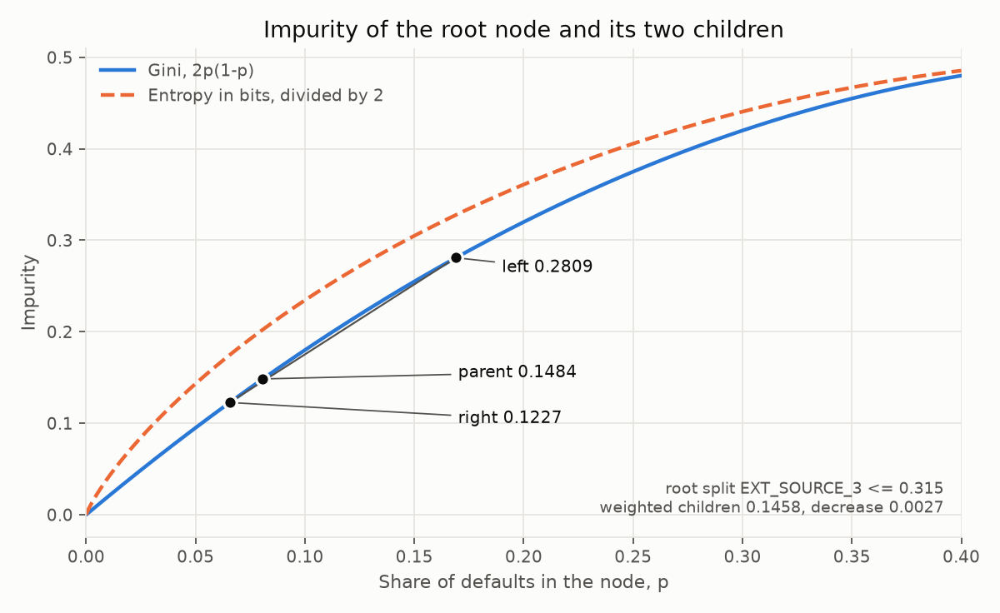

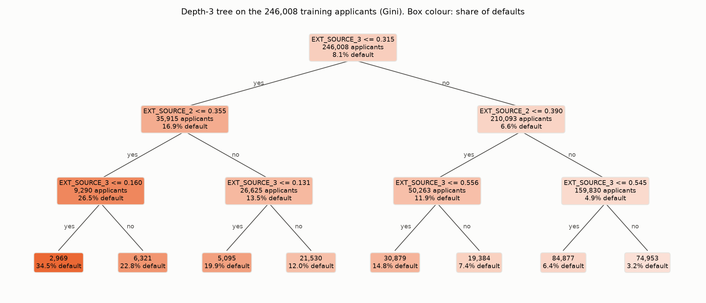

- The two criteria pick different columns at the root, but each split is almost as good under the other measure: the Gini split has an entropy decrease of 0.0106 against 0.0111 for the entropy split, and the entropy split has a Gini decrease of 0.0025 against 0.0027.
- The best root split lowers the Gini impurity by 0.0027, 1.8% of 0.1484. Defaults are rare and a single column separates them only partly. The three levels together use only `EXT_SOURCE_2` and `EXT_SOURCE_3`.
- The eight leaves of the depth-3 tree run from 3.2% defaults (74,953 applicants) to 34.5% (2,969 applicants), a factor of 10.8, against the base rate of 8.1%.

### Depth and overfitting

`max_depth` from 1 to 30 and with no limit, 5-fold stratified cross-validation on the 246,008 training applicants. Mean over folds, validation fold:

| `max_depth` | Leaves | PR-AUC | ROC-AUC | Log loss |
|---:|---:|---:|---:|---:|
| 1 | 2 | 0.1076 | 0.5869 | 0.2732 |
| 3 | 8 | 0.1566 | 0.6826 | 0.2629 |
| 5 | 32 | 0.1794 | 0.7059 | 0.2590 |
| 7 | 122 | 0.1866 | 0.7138 | 0.2659 |
| 10 | 572 | 0.1779 | 0.7044 | 0.3680 |
| 15 | 2,537 | 0.1507 | 0.6556 | 0.9148 |
| 30 | 11,870 | 0.1014 | 0.5173 | 3.7271 |
| none (depth 56 to 63) | 15,993 | 0.0904 | 0.5374 | 5.1014 |

- Validation PR-AUC peaks at depth 7 (0.1866, std 0.0053 over folds) and falls from there, while the training PR-AUC rises to 1.0 for the unlimited tree.
- Log loss is best at depth 5 (0.2590) and is worse than the 0.2805 of predicting the base rate from depth 8 on (0.2834), because a deep tree gives leaves with a few applicants probabilities close to 0 or 1.
- The best tree is below the logistic regression (PR-AUC 0.2249) and just below the `EXT_SOURCE` mean baseline (0.1889).

## Random forest

A random forest fits many decision trees, each on a bootstrap sample of the training rows and with only a random subset of the columns tried at each split, and predicts the mean of the trees' leaf probabilities. All forests here use the Gini criterion and the same pipeline as above on 300 columns. Settings were swept one at a time on the same 5 folds, validation fold, mean (std over folds):

The three sweeps ran in this order and each used the best setting of the one before: leaf size first (100 trees, 17 columns per split), then columns per split (100 trees, `min_samples_leaf` = 30), then the number of trees (`min_samples_leaf` = 30, 30 columns).

| `min_samples_leaf` | Train PR-AUC | Validation PR-AUC | Validation log loss |
|---:|---:|---:|---:|
| 1 | 1.0000 | 0.1967 (0.0022) | 0.2711 (0.0024) |
| 10 | 0.7741 | 0.2193 (0.0033) | 0.2538 (0.0001) |
| 30 | 0.4469 | 0.2211 (0.0024) | 0.2542 (0.0004) |
| 100 | 0.2903 | 0.2172 (0.0021) | 0.2558 (0.0003) |
| 1000 | 0.2163 | 0.2049 (0.0019) | 0.2614 (0.0003) |

| `max_features` | Validation PR-AUC | Validation ROC-AUC | Validation log loss |
|---:|---:|---:|---:|
| 1 | 0.1582 (0.0046) | 0.6483 (0.0054) | 0.2754 (0.0003) |
| 10 | 0.2135 (0.0028) | 0.7326 (0.0012) | 0.2576 (0.0003) |
| 17 (square root of 300) | 0.2211 (0.0024) | 0.7400 (0.0016) | 0.2542 (0.0004) |
| 30 | 0.2254 (0.0024) | 0.7432 (0.0010) | 0.2518 (0.0002) |
| 100 | 0.2244 (0.0034) | 0.7411 (0.0016) | 0.2510 (0.0004) |
| 300 (every column, plain bagging) | 0.2208 (0.0042) | 0.7359 (0.0024) | 0.2523 (0.0007) |

| Trees | Validation PR-AUC | Validation ROC-AUC | Validation log loss |
|---:|---:|---:|---:|
| 1 | 0.1368 (0.0049) | 0.6316 (0.0040) | 0.7909 (0.0137) |
| 10 | 0.2052 (0.0002) | 0.7206 (0.0028) | 0.2576 (0.0010) |
| 50 | 0.2222 (0.0030) | 0.7402 (0.0015) | 0.2523 (0.0003) |
| 100 | 0.2254 (0.0024) | 0.7432 (0.0010) | 0.2518 (0.0002) |
| 200 | 0.2266 (0.0026) | 0.7449 (0.0010) | 0.2515 (0.0003) |
| 500 | 0.2274 (0.0026) | 0.7462 (0.0012) | 0.2513 (0.0003) |

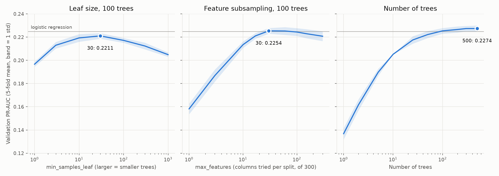

- With one tree the forest scores 0.1368. Averaging 500 of the same trees gives 0.2274, and the validation score did not fall at any tree count up to 500. It is flat from about 200 trees (0.2266 against 0.2274).
- The trees need a minimum leaf size. With `min_samples_leaf` = 1 the training PR-AUC is 1.0 and the validation PR-AUC 0.1967. Averaging many such trees helps, but not enough to make up for the leaves with one applicant each.
- Trying one column per split is the worst setting (0.1582). The score is flat from 30 to 100 columns and drops slightly for all 300 (0.2208), where every tree sees the same strongest columns and the trees are more alike.
- The forest with 500 trees, 30 columns per split and `min_samples_leaf` = 30 has PR-AUC 0.2274 (0.0026), ROC-AUC 0.7462 and log loss 0.2513. The logistic regression has 0.2249 (0.0045), 0.7475 and 0.2495. The PR-AUC difference is smaller than the fold-to-fold std, and the logistic regression is ahead on ROC-AUC and log loss.
- The three settings were chosen on the same folds that are reported, so these scores are slightly optimistic. The holdout is not used yet.

### Variance reduction of bagging

Let $T_1, \dots, T_B$ be the predictions of $B$ trees for one applicant, each with variance $\sigma^2$ and pairwise correlation $\rho$. The forest predicts their mean, with variance

$$
\mathrm{Var}\left(\frac{1}{B}\sum_{b=1}^{B} T_b\right) = \rho\,\sigma^2 + \frac{1-\rho}{B}\,\sigma^2
$$

More trees remove the second term but not the first, so $\rho\,\sigma^2$ is the floor. Bootstrap sampling and random columns per split make the trees different, which lowers $\rho$. The correlation is the one between trees across training sets, so it is measured on 8 training sets, each a random 100,000-row subsample of the 196,806 rows of fold 0, with 30 trees per set (`min_samples_leaf` = 30) and the variance taken over the 49,202 validation applicants of that fold. The variance of the mean of groups of $b$ trees is regressed on $1/b$, which gives $\rho\,\sigma^2$ as the intercept and $(1-\rho)\,\sigma^2$ as the slope (`src/forest_math.py`).

| Columns per split | Variance of one tree, $\sigma^2$ | Correlation $\rho$ | Floor $\rho\,\sigma^2$ | Variance of 30 trees | Ratio |
|---:|---:|---:|---:|---:|---:|
| 10 | 0.00558 | 0.004 | 0.00002 | 0.00021 | 1 / 26.6 |
| 30 | 0.00823 | 0.004 | 0.00004 | 0.00032 | 1 / 26.1 |
| 300 (plain bagging) | 0.01082 | 0.019 | 0.00021 | 0.00057 | 1 / 18.8 |

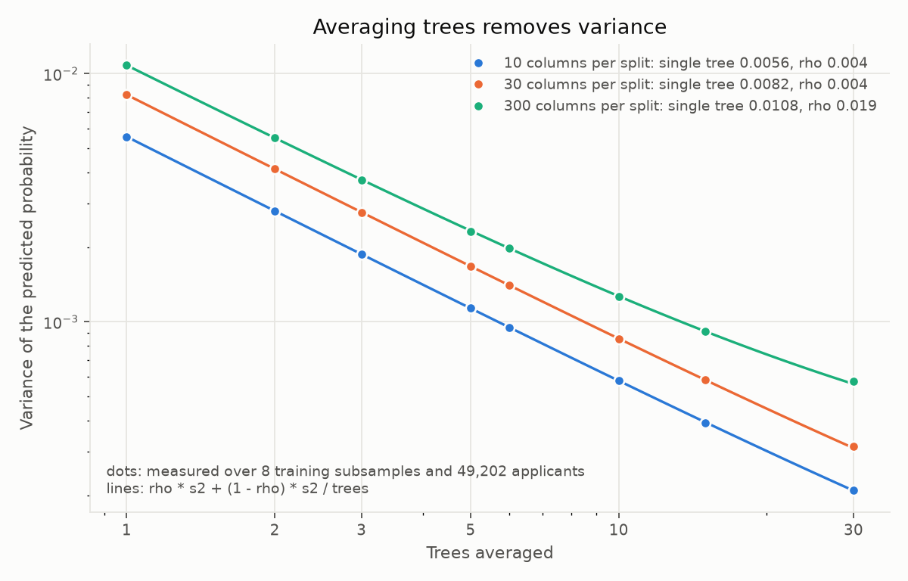

- The measured variance of the average follows the formula, within 2.2% at every point of the 3 settings. A single tree's prediction has a standard deviation of 0.075 to 0.104 across forests, as large as the base rate (0.081), and the mean of 30 trees 0.014 to 0.024.
- Using all 300 columns at every split gives the largest variance per tree and the highest correlation (0.019 against 0.004). Fewer columns make the trees more different from each other and each tree's predictions more stable.
- Less variance is not the same as a better forest. 10 columns per split has the lowest variance but a validation PR-AUC of 0.2135 against 0.2254 for 30, because trees that see few columns are weaker on average. The best setting balances the two.
- The 8 training sets overlap, since each is half of the same 196,806 rows, so they differ less than independent samples would. The $\rho$ values are lower bounds. What the measurement does show is that the trees of one forest are almost interchangeable draws and their average loses nearly all of the single-tree variance.

## Gradient boosting with LightGBM

LightGBM fits trees one after another. Each new tree is fitted to the gradient of the log loss at the current predictions, and its output times the learning rate is added to the running score. Settings are LightGBM's defaults (31 leaves per tree, at least 20 applicants per leaf, no row or column sampling, no penalty) except the learning rate, and the pipeline is the same as for the forest. The number of rounds is chosen by early stopping: 10% of each training fold is held out, training stops when its log loss has not improved for 100 rounds, and the model keeps the rounds up to the best one. The validation fold is only used to score the result.

### The update and the gradient it fits

The model is a score $F(x)$ on the log-odds scale, with $\hat p = \sigma(F)$, as in logistic regression. The log loss of one applicant as a function of the score is $\ell(y, F) = -yF + \log(1 + e^{F})$, with

$$
\frac{\partial \ell}{\partial F} = \sigma(F) - y = \hat p - y,
\qquad
\frac{\partial^2 \ell}{\partial F^2} = \hat p\,(1 - \hat p)
$$

Boosting starts from the base rate, $F_0 = \log \frac{\pi}{1-\pi}$, which is $-2.4325$ for $\pi = 0.0807$. Round $m$ then does three things:

1. Compute for every training applicant the negative gradient, called the residual: $r_i = y_i - \hat p_i = -\,\partial \ell / \partial F\,\big|_{F_{m-1}(x_i)}$.
2. Fit a regression tree $h_m$ with leaves $R_1, \dots, R_J$ to the residuals $r_i$ by squared error, so each leaf collects applicants whose current probabilities are wrong in the same direction.
3. Set each leaf to a Newton step on the log loss of its applicants, the sum of the gradients divided by the sum of the second derivatives, and add the tree to the score with a learning rate $\eta$:

$$
\gamma_j = \frac{\sum_{i \in R_j} r_i}{\sum_{i \in R_j} \hat p_i (1 - \hat p_i) + \lambda},
\qquad
F_m(x) = F_{m-1}(x) + \eta\, h_m(x), \quad h_m(x) = \gamma_{j(x)}
$$

Here $\lambda$ is the L2 penalty on the leaf values (`reg_lambda`). For the loss of a leaf under a constant shift $\gamma$, $\sum_i \ell \approx \gamma \sum_i (\hat p_i - y_i) + \tfrac12 \gamma^2 \sum_i \hat p_i (1 - \hat p_i)$ is smallest at the $\gamma_j$ above. Each round is a gradient step on the scores of the training applicants, as $w \leftarrow w - \eta \nabla_w$ is for the weights of the logistic regression, and the tree makes that step apply to new applicants by giving all applicants in a leaf the same step.

`src/boosting_math.py` does this in about 40 lines with scikit-learn's `DecisionTreeRegressor` for step 2 (31 leaves, at least 20 applicants per leaf, $\eta = 0.1$, $\lambda = 0$) on fold 0 of the 5-fold split, with the same preprocessing as above. On small test problems its scores equal those of scikit-learn's `GradientBoostingClassifier` to within $4 \times 10^{-15}$ after 30 rounds (`tests/test_boosting_math.py`; that class has to be given `max_depth=None`, because its default depth limit of 3 overrides the leaf limit). On the real data, round 1 looks like this:

- Every applicant has $\hat p = 0.0807$, so the residual is $+0.9193$ for a defaulter and $-0.0807$ for everyone else.
- The first tree has 31 leaves with values $\gamma_j$ from $-0.736$ to $+5.819$. The largest is a leaf of 119 applicants of whom 51.3% defaulted. Multiplied by $\eta = 0.1$, the scores move by $-0.074$ to $+0.582$, which puts the probabilities between 0.0754 and 0.1358.

Against LightGBM with the same settings (31 leaves, 20 applicants per leaf, no penalty, no sampling), same fold, fixed 150 rounds without early stopping:

| Round | Training log loss, hand-written / LightGBM | Validation log loss, hand-written / LightGBM | Validation PR-AUC, hand-written / LightGBM |
|---:|---|---|---|
| 1 | 0.2749 / 0.2750 | 0.2753 / 0.2754 | 0.1808 / 0.1807 |
| 10 | 0.2563 / 0.2561 | 0.2589 / 0.2582 | 0.2056 / 0.2096 |
| 50 | 0.2409 / 0.2398 | 0.2495 / 0.2485 | 0.2284 / 0.2283 |
| 100 | 0.2337 / 0.2313 | 0.2486 / 0.2477 | 0.2312 / 0.2306 |
| 150 | 0.2279 / 0.2244 | 0.2487 / 0.2478 | 0.2309 / 0.2298 |

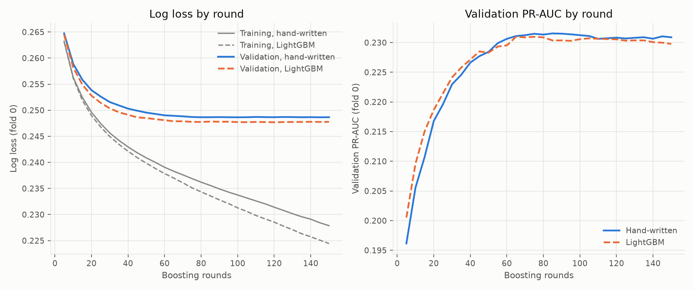

- The two follow each other closely. The validation log loss of the hand-written loop is higher by 0.0009 on average and by at most 0.0013, and the validation PR-AUC peaks at 0.2315 (round 85) against 0.2310 (round 75) for LightGBM.
- LightGBM fits the training data a little faster (0.2244 against 0.2279 at round 150). It searches 255 bins per column instead of every cut point, and it picks splits with the gradient and the second derivative, where the loop fits the residuals by squared error.
- Both have the shape of the score-by-round chart below: the training loss keeps falling, and the validation loss stops improving at about round 80 and then stays flat.
- The loop took 554 s for 150 rounds, against 2.3 s for a LightGBM early-stopped fit at this learning rate (table below), which is the reason the libraries are used for the model results.

### Learning rate and rounds

5-fold stratified cross-validation, validation fold, mean (std over folds):

| Learning rate | Best round | Fit time | PR-AUC | ROC-AUC | Log loss |
|---:|---:|---:|---:|---:|---:|
| 0.30 | 21 (4) | 1.7 s | 0.2269 (0.0057) | 0.7489 (0.0022) | 0.2494 (0.0008) |
| 0.10 | 85 (18) | 2.3 s | 0.2366 (0.0063) | 0.7537 (0.0017) | 0.2475 (0.0006) |
| 0.05 | 232 (67) | 3.8 s | 0.2389 (0.0051) | 0.7554 (0.0017) | 0.2471 (0.0006) |
| 0.02 | 581 (108) | 6.9 s | 0.2401 (0.0052) | 0.7563 (0.0017) | 0.2468 (0.0005) |

Fit time is the early-stopped fit on 16 cores, including the 100 rounds after the best one.

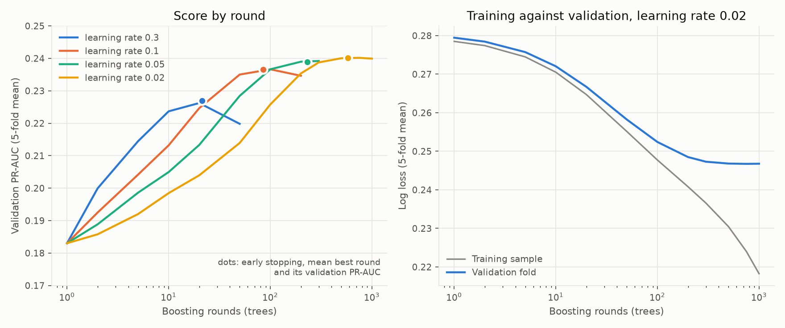

- A smaller learning rate needs more rounds and scores better: PR-AUC 0.2269 at 0.3 and 0.2401 at 0.02. The gain from 0.05 to 0.02 (0.0012) is smaller than the std over folds.
- The validation score is flat for a long time after its best round and does not fall steeply as the decision tree did. At learning rate 0.02 the validation log loss is 0.2468 from round 500 to round 1000 while the training log loss falls from 0.2305 to 0.2182.
- At learning rate 0.3 or 0.1 the validation PR-AUC does turn down after the best round (0.2262 at 20 rounds, 0.2198 at 50 for 0.3). The best round also varies between folds, from 18 to 27 at 0.3 and from 424 to 690 at 0.02.
- LightGBM at 0.02 has PR-AUC 0.2401 (0.0052), against 0.2274 (0.0026) for the forest and 0.2249 (0.0045) for the logistic regression, and ROC-AUC 0.7563 against 0.7462 and 0.7475. The settings other than the learning rate are untuned.
- The score-by-round curves show the mean of the 5 folds at a grid of round numbers, and only the rounds that every fold reached, up to 3 times the fold's best round. The dots are the exact early-stopped results, so they can sit slightly above the curve.

### XGBoost

XGBoost with its defaults (depth-wise trees of at most 6 levels, so at most 64 leaves, histogram split search, no sampling) and the same protocol: same folds, same 10% early-stopping part, log loss with a patience of 100 rounds, same four learning rates. Validation fold, mean (std over folds), with LightGBM from above:

| Learning rate | Library | Best round | Fit time | PR-AUC | ROC-AUC | Log loss |
|---:|---|---:|---:|---:|---:|---:|
| 0.10 | LightGBM | 85 (18) | 2.3 s | 0.2366 (0.0063) | 0.7537 (0.0017) | 0.2475 (0.0006) |
| 0.10 | XGBoost | 146 (28) | 5.8 s | 0.2376 (0.0048) | 0.7549 (0.0005) | 0.2472 (0.0004) |
| 0.02 | LightGBM | 581 (108) | 6.9 s | 0.2401 (0.0052) | 0.7563 (0.0017) | 0.2468 (0.0005) |
| 0.02 | XGBoost | 724 (78) | 18.4 s | 0.2401 (0.0050) | 0.7563 (0.0014) | 0.2467 (0.0004) |

- The two libraries give the same scores. Fold by fold, the LightGBM minus XGBoost difference in PR-AUC at learning rate 0.02 has mean 0.0000 and std 0.0012, and at 0.05 it is -0.0005 (std 0.0015).
- XGBoost needs more rounds (724 against 581 at 0.02) and 2.1 to 2.7 times the fit time (LightGBM's time is 0.37 to 0.47 of XGBoost's at each learning rate), on 16 cores.
- Both libraries gain from a smaller learning rate in the same way, from 0.2281 (XGBoost) and 0.2269 (LightGBM) at 0.3 to 0.2401 for both at 0.02.

### Tuning with Optuna

LightGBM at learning rate 0.05 was tuned with Optuna (TPE sampler, seed 42) for 60 trials. Each trial is scored as the mean validation PR-AUC over the same 5 folds, with the rounds chosen by early stopping as above, and a median pruner stops a trial after a fold if its running mean is below the median of earlier trials (never in the first 10 trials). The first trial is the default setting. Every trial is stored with its settings, scores, best round and time in `results/optuna_trials.csv`.

| Setting | Range searched | Default (trial 0) | Best trial (57) |
|---|---|---:|---:|
| `num_leaves` | 8 to 256, log | 31 | 9 |
| `min_child_samples` | 10 to 300, log | 20 | 206 |
| `subsample` (row fraction, every round) | 0.5 to 1 | 1 | 0.85 |
| `colsample_bytree` | 0.3 to 1 | 1 | 0.56 |
| `reg_alpha` (L1 on leaf values) | 0.001 to 10, log | 0.001 | 0.024 |
| `reg_lambda` (L2 on leaf values) | 0.001 to 10, log | 0.001 | 7.5 |

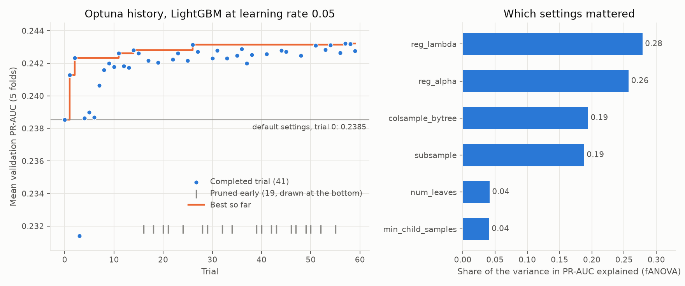

- 41 trials completed and 19 were pruned. The study took 24 minutes. The best trial reached a mean PR-AUC of 0.2432, against 0.2385 for the default setting, and 39 of the 41 completed trials beat the default.
- The scores of the best trials are very close: the five best are between 0.2431 and 0.2432, with settings that differ a lot (`num_leaves` from 8 to 27). The surface is flat near the top.
- The best settings are simpler trees (9 leaves) with strong L2 and L1 penalties and sampling of rows and columns. `reg_lambda` and `reg_alpha` explain the most of the variance between trials (0.28 and 0.26 by fANOVA), the sampling fractions 0.19 each, `num_leaves` and `min_child_samples` 0.04 each.
- Several of the best settings sit at the edge of the range searched: `num_leaves` 8 to 9 (lower limit 8) and `reg_lambda` up to 9.7 (upper limit 10). A wider range might find slightly more.

The best trial's score is the best of 60, so it is checked on a new split: the default and the tuned settings were scored on 5 folds drawn with a different seed (7), at learning rate 0.05 and at 0.02. Mean (std over folds), and the mean of the fold-by-fold difference (tuned minus default):

| Learning rate | Settings | Best round | PR-AUC | ROC-AUC | Log loss |
|---:|---|---:|---:|---:|---:|
| 0.05 | default | 226 (51) | 0.2388 (0.0030) | 0.7554 (0.0033) | 0.2471 (0.0005) |
| 0.05 | tuned | 797 (214) | 0.2431 (0.0030) | 0.7587 (0.0037) | 0.2461 (0.0007) |
| 0.05 | difference | | +0.0042 (0.0011) | +0.0033 (0.0014) | -0.0010 (0.0004) |
| 0.02 | default | 643 (151) | 0.2401 (0.0033) | 0.7560 (0.0033) | 0.2469 (0.0006) |
| 0.02 | tuned | 1,937 (551) | 0.2432 (0.0038) | 0.7591 (0.0031) | 0.2460 (0.0006) |
| 0.02 | difference | | +0.0030 (0.0015) | +0.0031 (0.0010) | -0.0009 (0.0003) |

- On the new folds the tuned settings score 0.2431, the same as on the tuning folds (0.2432), so the choice of settings did not overfit those folds.
- The tuned model beats the default in every one of the 10 fold comparisons on all three metrics (smallest PR-AUC gain 0.0012). The gain is small compared with the spread over folds, but it is paired, and it is 0.003 to 0.004 PR-AUC.
- The tuned model needs 3 to 4 times as many rounds, because trees of 9 leaves with strong penalties take smaller steps.
- The holdout is not used yet.

## k nearest neighbours

kNN has no training step. The model keeps the training rows and, for a new applicant $x$, predicts the share of defaulters among the $k$ training applicants closest to $x$:

$$
\hat p(x) = \frac{1}{k} \sum_{i \in N_k(x)} y_i, \qquad d(x, x')^2 = \sum_{j=1}^{p} (x_j - x'_j)^2
$$

Here $N_k(x)$ is the set of the $k$ training rows with the smallest distance $d$. The distances are computed on the clipped and standardised columns of the pipeline, so every column has variance 1 and counts equally. `src/knn_math.py` computes them as $\lVert x \rVert^2 - 2\, x \cdot x' + \lVert x' \rVert^2$ and the probabilities as the mean of $y$ over the $k$ nearest rows. Both match the direct sum of squares and scikit-learn's `KNeighborsClassifier` (`tests/test_knn_math.py`).

There is no loss to minimise. The only setting is $k$, which trades variance for bias. $\hat p$ is an average of $k$ labels, so with a base rate of $\pi = 0.081$ its sampling noise is about $\sqrt{\pi (1 - \pi) / k}$: 0.122 for $k = 5$, 0.039 for $k = 50$ and 0.012 for $k = 500$. With $k = 5$ the prediction can only take the values 0, 0.2, 0.4, … and the noise is larger than the base rate itself.

### Distance in many columns

With many columns, the nearest neighbour is hardly nearer than a typical applicant. For 300 validation applicants and 20,000 training rows, taking a random subset of the 70 continuous columns, the table gives the mean distance to the nearest training row, the mean median distance, and the mean of their ratio per applicant (`results/knn_distance.csv`, mean of 5 draws of columns):

| Columns | Nearest | Median | Nearest / median |
|---:|---:|---:|---:|
| 1 | 0.0001 | 0.411 | 0.000 |
| 2 | 0.0048 | 0.738 | 0.004 |
| 5 | 0.0649 | 1.821 | 0.031 |
| 10 | 0.3176 | 3.065 | 0.084 |
| 20 | 0.9578 | 4.678 | 0.189 |
| 40 | 2.0650 | 6.595 | 0.300 |
| 70 | 3.6363 | 9.079 | 0.400 |

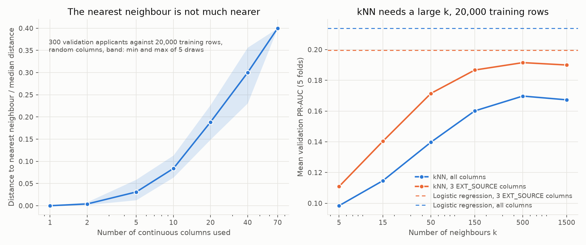

- On one column the nearest of 20,000 rows is almost on top of the applicant. On 70 columns it is at 40% of the typical distance. The neighbours stop being much more alike than anyone else, so a small $k$ averages labels of loosely related applicants.
- PR-AUC at $k = 5$ is 0.0984 on 20,000 training rows and 300 columns, and it rises to 0.1698 at $k = 500$ before falling to 0.1673 at $k = 1500$. The best kNN stays below the logistic regression on the same 20,000 rows (0.2139). On the 3 `EXT_SOURCE` columns the best kNN reaches 0.1915 at $k = 500$, against 0.1995 for the logistic regression.
- Fitting takes 0.004 s and predicting 49,202 validation applicants takes 3.5 s at $k = 500$. The cost sits at prediction, and it grows with the number of training rows, which is why kNN is run on a subsample.

## Support vector machine

A support vector machine scores an applicant with $f(x)$ and predicts the default class when $f(x) > 0$. With labels $y_i \in \{-1, +1\}$, the soft-margin problem is

$$
\min_{w, b} \; \tfrac12 \lVert w \rVert^2 + C \sum_{i=1}^{n} c_i \max\bigl(0,\, 1 - y_i f(x_i)\bigr), \qquad f(x) = w \cdot \phi(x) + b
$$

The second term is the hinge loss. It is zero for an applicant on the right side of the line by at least 1 ($y_i f(x_i) \ge 1$) and grows linearly below that, so correctly classified applicants beyond the margin have no say in the solution. The first term makes the margin, the strip $|f| < 1$ of width $2 / \lVert w \rVert$, as wide as possible. $C$ sets how much a point inside the strip costs against the width. $c_i$ are the class weights: `class_weight="balanced"` gives each class the same total weight, $c_i = n / (2 n_{y_i})$.

The kernel version does not compute $\phi$. The dual problem is

$$
\max_{\alpha} \; \sum_i \alpha_i - \tfrac12 \sum_{i,j} \alpha_i \alpha_j\, y_i y_j\, K(x_i, x_j), \qquad 0 \le \alpha_i \le C c_i, \quad \sum_i \alpha_i y_i = 0
$$

and the score is $f(x) = \sum_i \alpha_i y_i K(x_i, x) + b$, where only the support vectors ($\alpha_i > 0$) enter. The kernel is the RBF, $K(x, x') = \exp(-\gamma \lVert x - x' \rVert^2)$, with $\gamma = 0.1 / (p \cdot \mathrm{Var}(Z))$ as chosen in the sweep. $\lVert w \rVert^2 = \sum_{i,j} \alpha_i \alpha_j y_i y_j K(x_i, x_j)$ is computed from the dual coefficients.

`src/svm_math.py` checks three things on fold 0 with a 5,000-row subsample (`tests/test_svm_math.py`): the score from the kernel sum over the support vectors equals scikit-learn's `decision_function`, the primal and dual objectives agree at the optimum, and the hinge loss is 0, 0.5, 1 and 2 at the margins 1, 0.5, 0 and -1. The SVM gives a score, not a probability, so the probabilities used in the project come from a sigmoid fitted on top (Platt scaling, 3 folds).

| $C$ | Support vectors | At the upper bound ($\alpha_i = C c_i$) | Margin width | Primal | Dual | Training hinge | Validation hinge | Validation ROC-AUC |
|---:|---:|---:|---:|---:|---:|---:|---:|---:|
| 0.1 | 4,812 (96.2%) | 95.9% | 0.2468 | 447.551 | 447.550 | 0.829 | 0.846 | 0.6733 |
| 1 | 4,001 (80.0%) | 78.3% | 0.0834 | 3672.24 | 3672.23 | 0.677 | 0.762 | 0.7217 |
| 10 | 3,472 (69.4%) | 65.1% | 0.0252 | 30537.4 | 30536.9 | 0.548 | 0.775 | 0.7127 |

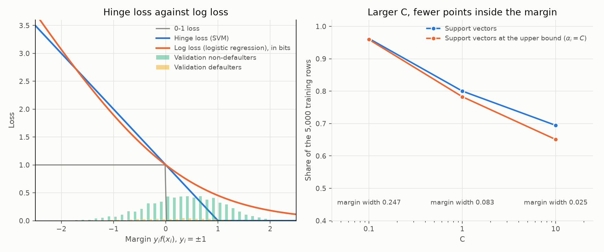

- The hinge loss and the log loss of logistic regression have nearly the same shape for margins below 0, with the log loss written in bits so both equal 1 at a margin of 0. The difference is on the right: the log loss never reaches 0, so every applicant keeps pulling on the logistic regression, while the hinge loss ignores applicants beyond the margin.
- On this data almost every applicant is inside the margin. Of the 5,000 training rows 80% are support vectors at $C = 1$, and 78% of the rows sit at the upper bound, which means they are inside the strip or misclassified. The validation scores $f(x)$ are mostly between -1 and 1 (non-defaulters mean -0.384, defaulters mean 0.196), so the classes overlap and the margin is not a clean gap.
- A larger $C$ narrows the margin (0.2468, 0.0834, 0.0252) and lowers the training hinge loss (0.829, 0.677, 0.548), but the validation hinge loss is lowest at $C = 1$ (0.762) and rises at $C = 10$ (0.775). The best validation ROC-AUC is also at $C = 1$.
- The primal and dual values agree to 4 significant digits or better at every $C$ (the largest gap is 0.5 out of 30,537), which confirms the optimiser reached the optimum.
- With the full SVM, 20,000 rows took 84.7 s to fit and 97.5 s to predict the validation fold, against 2.1 s and 0.01 s for the logistic regression, at PR-AUC 0.2123 against 0.2139.

## PCA

Let $Z$ be the $n \times p$ matrix of the 70 continuous application columns, clipped, standardised and then centred on the training fold. PCA is the eigen-decomposition of their covariance matrix:

$$
\Sigma = \frac{1}{n - 1} Z^\top Z = V \Lambda V^\top, \qquad \Lambda = \mathrm{diag}(\lambda_1 \ge \dots \ge \lambda_p), \quad V^\top V = I
$$

The columns of $V$ are the components and $\lambda_j$ is the variance of the scores $ZV$ along component $j$. The scores are uncorrelated and the share of the variance held by component $j$ is $\lambda_j / \sum_l \lambda_l$. For standardised columns the total variance is $p = 70$. Keeping the first $k$ components gives the reconstruction $\hat Z_k = Z V_k V_k^\top$. Among all rank-$k$ approximations it has the smallest squared error (the Eckart-Young theorem), and the error is the variance that was discarded:

$$
\frac1n \sum_i \lVert z_i - \hat z_{i,k} \rVert^2 = \frac{n-1}{n} \sum_{j > k} \lambda_j
$$

`src/pca_math.py` computes the eigenvalues with `numpy.linalg.eigh` and measures the reconstruction error directly. The eigenvalues equal scikit-learn's `explained_variance_`, the eigenvectors are orthonormal, and on the training rows the measured error equals the sum of the discarded eigenvalues (`tests/test_pca_math.py`).

| Components kept | Training error | Validation error | Share of variance kept |
|---:|---:|---:|---:|
| 0 | 70.000 | 70.174 | 0.0% |
| 1 | 51.753 | 51.696 | 26.1% |
| 18 | 13.910 | 13.972 | 80.1% |
| 30 | 3.375 | 3.454 | 95.2% |
| 38 | 0.572 | 0.597 | 99.2% |

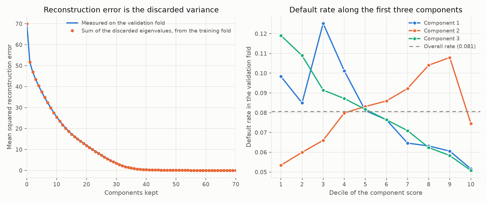

- The error computed on the validation fold follows the discarded eigenvalues of the training fold. It is slightly higher (3.454 against 3.375 at 30 components), because the components were fitted on the training rows.
- Ordering by variance is not ordering by relation to default. In the validation fold the default rate runs from 9.8% in the lowest decile of component 1 to 5.2% in the highest, but not monotonically (12.5% in decile 3). For component 2 it rises from 5.3% to 10.8% in decile 9 and then drops to 7.5% in decile 10. Component 3, which holds less variance, runs from 11.9% to 5.1%, a spread as large as the first two.
- Keeping the components with the most variance does not keep the signal: logistic regression on the first 30 components, which keep 95% of the variance, has PR-AUC 0.1988 against 0.2061 on the 70 columns, and LightGBM 0.2010 against 0.2303. The charts of the scree plot and of the models on components are in `docs/img/pca.png`.

## k-means

k-means partitions the rows into $k$ clusters with centroids $\mu_1, \dots, \mu_k$ and minimises the within-cluster sum of squares (the inertia):

$$
J(c, \mu) = \sum_{i=1}^{n} \lVert x_i - \mu_{c(i)} \rVert^2, \qquad c(i) \in \{1, \dots, k\}
$$

Lloyd's algorithm alternates two steps, each of which can only lower $J$:

1. Assign: $c(i) = \arg\min_m \lVert x_i - \mu_m \rVert^2$. With the centroids fixed, this is the cluster that minimises each term.
2. Update: $\mu_m = \frac{1}{|C_m|} \sum_{i \in C_m} x_i$. With the assignment fixed, the mean is the point that minimises the sum of squared distances to the cluster's rows.

$J$ is bounded below by 0 and there are finitely many assignments, so the loop ends when no row changes cluster. It stops at a local minimum, not necessarily the best one, so the result depends on the start. scikit-learn's default start is k-means++ and `n_init` restarts keep the best.

`src/kmeans_math.py` runs the two steps by hand on the 70 continuous columns of the 196,806 training rows of fold 0 with $k = 5$, from 5 random starts (5 rows picked at random as the first centroids). In every iteration $J$ after the assign step is no higher than after the previous update step, and $J$ after the update step is no higher than after the assign step (`tests/test_kmeans_math.py`). Run from the same start, scikit-learn's Lloyd loop ends at the same $J$ (relative difference at most $3 \times 10^{-6}$).

| Start | Iterations | $J$ after the first assignment | $J$ at the end | scikit-learn from the same start |
|---:|---:|---:|---:|---:|
| 0 | 70 | 14.55 million | 10.167 million | 10.167 million |
| 1 | 116 | 13.46 million | 10.239 million | 10.239 million |
| 2 | 45 | 14.25 million | 10.176 million | 10.176 million |
| 3 | 53 | 15.51 million | 10.359 million | 10.359 million |
| 4 | 62 | 13.27 million | 10.564 million | 10.564 million |

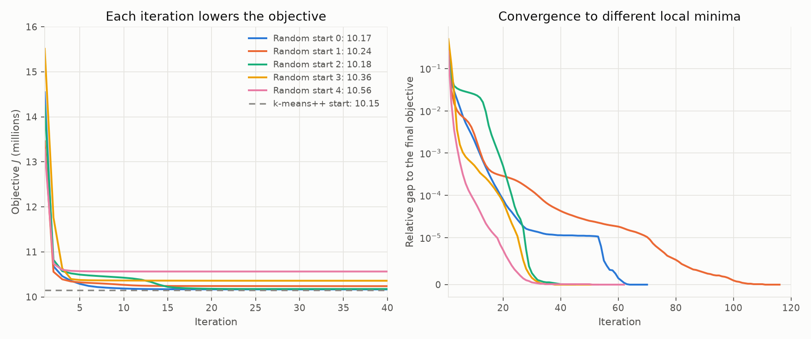

- Most of the fall comes at the start. After the first update $J$ is 1.7% to 13.5% above its final value, after 5 iterations 0.1% to 3.1%, and after 20 iterations at most 0.05%. The remaining iterations of the 45 to 116 only move the few rows near a boundary between two clusters.
- The five starts end at five different values, from 10.167 to 10.564 million (a spread of 3.9%), so these are different local minima. The k-means++ start of the main k-means step reaches 10.151 million in this fold, lower than all five random starts.
- Per row, $J$ is 70 for $k = 1$ (the 70 standardised columns) and, as the mean over the 5 training folds, 58.3, 54.9, 51.1, 45.6, 41.6 and 36.8 for $k = 2, 3, 5, 8, 12, 20$. At $k = 5$ the clusters explain 27.0% of the total variance and at $k = 20$ 47.4%, so most of the variance stays inside the clusters. The silhouette scores (0.49 at $k = 2$, 0.13 at $k = 5$) and the default rates per cluster are in the k-means section of `README.md` and in `docs/img/kmeans.png`.

## Imbalance, calibration and thresholds

Notation as above, with $\pi = 0.0807$ the base rate, $\hat p_i$ a predicted probability and $\sigma(z) = 1/(1 + e^{-z})$. The working code is in `src/imbalance.py`, `src/calibration.py`, `src/threshold.py` and the checks of this section in `src/weighted_math.py`.

### Weighted log loss

Class weights multiply each applicant's log loss by $c_i$, with $c_i = w$ for a defaulter and $c_i = 1$ for everyone else:

$$
L_w = -\frac1n \sum_{i=1}^{n} c_i \left[\, y_i \log \hat p_i + (1 - y_i) \log (1 - \hat p_i) \,\right]
$$

A weight of $w$ is the same loss as copying every defaulter $w$ times (`tests/test_weighted_math.py`), and random oversampling is that with whole numbers of copies. "Balanced" weights take $w = (1 - \pi)/\pi = N/P = 11.39$, so both classes carry the same total weight.

The weights change what the best prediction is. For a group of applicants with true default probability $p$ the prediction $q$ that minimises $L_w$ solves $\frac{d}{dq}\left[ -w p \log q - (1 - p) \log (1 - q) \right] = 0$, which gives

$$
q^\star = \frac{w\,p}{w\,p + 1 - p}, \qquad \frac{q^\star}{1 - q^\star} = w \cdot \frac{p}{1 - p}
$$

The odds are multiplied by $w$, equivalently the log-odds are shifted by $\log w = 2.43$. With $w = (1 - \pi)/\pi$ the best constant prediction for the whole population is 0.5. Undersampling the repaid loans to the size of the defaulters changes the class ratio by the same factor and gives the same shift. For a logistic regression whose form is right, the weights change only the intercept, by $\log w$ (the slope is unchanged, tested on simulated data). To undo the shift, multiply the odds by $1/w$.

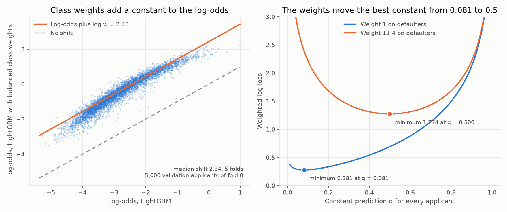

On the validation folds, for LightGBM with and without `scale_pos_weight` = 11.39 (`results/weighted_shift.csv`, 5 folds):

| Quantity | Value |
|---|---|
| $\log w$ | 2.4325 |
| Median log-odds shift of the weighted model, per fold | 2.30 to 2.37 |
| Correlation of the two log-odds | 0.956 to 0.965 |
| Slope of a line fitted to the two log-odds | 0.99 to 1.13 |
| Mean predicted probability, weighted model | 0.3995 to 0.4050 (base rate 0.081) |
| Mean of the formula $q^\star$ applied to the unweighted predictions | 0.413 to 0.432 |
| Log loss: unweighted / weighted / unweighted shifted by the formula | 0.2477 / 0.5584 / 0.5882 |
| Weighted log loss $L_w$: unweighted / weighted model | 2.0592 / 1.0830 |

- The weighted model's probabilities are the unweighted ones shifted by a nearly constant amount on the log-odds scale (the points lie along a line of slope 1), a bit less than the exact $\log w$: 2.34 against 2.43.
- The gap is a stretch, not a smaller shift. Fitting $z = a + b\,x$ to the log-odds $x$ (unweighted) and $z$ (weighted) gives $a \approx \log w$ for every model tried, and the mean shift is $a + (b - 1)\bar x$, so a slope $b$ above 1 at a mean log-odds $\bar x \approx -2.8$ lowers the shift. A logistic regression has $b = 1.01$ and a mean shift of 2.42. LightGBM with 300 rounds has $b$ = 1.03, 1.05, 1.08 and a mean shift of 2.38, 2.35, 2.23 with 4, 8, 31 leaves (`results/weighted_gap.csv`, fold 0). The weighted trees spread the log-odds more the more flexible they are. The stopping round and the L2 penalty were ruled out (the same number of rounds gives the same slope, and $\lambda = 10^{-3}$ is too small to matter); a larger `min_child_samples` did not close it. That the weights give the trees more to split on is the likely reason and was not tested further.
- The weighted model has the better weighted loss (1.083 against 2.059) and the much worse ordinary log loss (0.558 against 0.248). The ranking is unchanged to within noise (PR-AUC 0.2386 against 0.2386 in the imbalance comparison), which is why the weights are not a means of finding more defaulters here.

### Calibration

A model is calibrated when $P(y = 1 \mid \hat p = s) = s$ for every score $s$. The reliability diagram cuts the validation applicants into $B = 10$ groups of equal size by $\hat p$ and plots the mean prediction $\bar p_b$ against the default rate $\bar y_b$ of each group. Two numbers summarise it:

$$
\mathrm{ECE} = \sum_{b=1}^{B} \frac{n_b}{n} \left| \bar p_b - \bar y_b \right|, \qquad \mathrm{Brier} = \frac1n \sum_{i=1}^{n} (\hat p_i - y_i)^2
$$

Log loss and the Brier score are proper scoring rules: their expected value is smallest when $\hat p$ is the true probability, so a model trained on log loss is pushed towards calibration, and a model trained on a weighted loss is not.

Two calibrators are fitted on 20% of each training fold that the model did not see:

- Platt scaling: $\hat p' = \sigma(a \cdot \mathrm{logit}(\hat p) + b)$, with $a$ and $b$ found by logistic regression of $y$ on $\mathrm{logit}(\hat p)$. With $a > 0$ it keeps the order of the applicants, so PR-AUC and ROC-AUC are unchanged. A weight shift is the special case $a = 1$, $b = -\log w$.
- Isotonic regression: the non-decreasing step function $f$ that minimises $\sum_i (y_i - f(\hat p_i))^2$ (found by pooling adjacent applicants whose rates are out of order). It has no assumed shape, but its steps give many applicants the same probability.

| Model | ECE: none / Platt / isotonic | Log loss: none / Platt / isotonic | PR-AUC: none / Platt / isotonic |
|---|---|---|---|
| Logistic regression | 0.0025 / 0.0026 / 0.0031 | 0.2496 / 0.2496 / 0.2512 | 0.2246 / 0.2246 / 0.2175 |
| LightGBM | 0.0035 / 0.0032 / 0.0029 | 0.2477 / 0.2476 / 0.2491 | 0.2357 / 0.2357 / 0.2278 |
| LightGBM, class weights | 0.3205 / 0.0038 / 0.0040 | 0.5584 / 0.2475 / 0.2488 | 0.2363 / 0.2363 / 0.2269 |
| Random forest | 0.0129 / 0.0027 / 0.0039 | 0.2518 / 0.2501 / 0.2517 | 0.2256 / 0.2256 / 0.2177 |

- Fitted on the class-weighted LightGBM, Platt scaling finds $a$ = 1.04 to 1.08 and $b$ = -2.33 to -2.36 (`results/weighted_shift.csv`). The shift it removes is $b \approx -2.34$, close to $-\log w = -2.43$, with a slope near 1. After it the log loss is 0.2475, the same as for the unweighted LightGBM (0.2477).
- Logistic regression and LightGBM trained with the plain log loss are calibrated to within the noise of the measure, so the calibration step has nothing to repair (the log loss changes by at most 0.0001 with Platt scaling). The random forest averages leaf frequencies, which pulls predictions towards the middle (0.209 predicted against 0.256 observed in the top decile), and Platt scaling takes its ECE from 0.0129 to 0.0027.
- Isotonic regression gives the same calibration but lowers PR-AUC in every fold, by 0.0070 to 0.0094, because the steps make ties among the applicants.
- The ECE depends on the number of groups and has a noise floor, about 0.0025 for 49,000 applicants in 10 groups. Differences between 0.0025 and 0.0040 are not a real difference between models.

### Expected cost and the threshold

Flag an applicant, and refuse the loan, when $\hat p \ge t$. A missed default (accepting an applicant who defaults) costs $c_{FN}$ and a refused good loan costs $c_{FP}$. The cost of a threshold is

$$
C(t) = c_{FN} \cdot \mathrm{FN}(t) + c_{FP} \cdot \mathrm{FP}(t), \qquad r = \frac{c_{FN}}{c_{FP}}
$$

If $\hat p$ is the true probability, accepting an applicant has expected cost $\hat p\, c_{FN}$ and refusing one has expected cost $(1 - \hat p)\, c_{FP}$. Refusing is cheaper when $\hat p\, c_{FN} > (1 - \hat p)\, c_{FP}$, that is when

$$
\hat p > \frac{c_{FP}}{c_{FP} + c_{FN}} = \frac{1}{1 + r}
$$

so the best threshold is $t^\star = 1/(1 + r)$, and the expected cost per applicant at that threshold is $\mathbb{E}\left[\min\left(r\,\hat p,\; 1 - \hat p\right)\right] c_{FP}$. It needs calibrated probabilities. A model whose odds are $w$ times too large has its best threshold at the odds $w/r$, that is at $\sigma(\log w - \log r)$ in log-odds terms.

**Costs that scale with the loan.** The working cost is per loan: a missed default loses a share $\lambda = 0.45$ of the credit amount $a_i$ (the loss given default Basel uses for unsecured loans) and a refused good loan loses a margin $m = 0.10$ of it (an estimate of the interest income net of funding). Both are assumptions. With $c_{FN,i} = \lambda a_i$ and $c_{FP,i} = m\, a_i$ the loan size cancels in the comparison for one applicant, so the best threshold is the same for every loan,

$$
t^\star = \frac{m}{m + \lambda} = \frac{1}{1 + 4.5} = 0.182
$$

and the size only weights the cost totals: $C(t) = \sum_i a_i \left[\lambda\, \mathbb{1}(\text{missed}_i) + m\, \mathbb{1}(\text{refused good}_i)\right]$. The code divides by $m\,\bar a$, so the unit is one refused good loan of average size and the cost of a missed default is 4.5 in the same unit (`src/threshold.py`, scheme `amount`). A flat ratio of 4.5 (`flat_4.5`) and flat ratios of 2, 5, 10 and 20 are scored next to it.

With the loan-size weighted cost and $r = 4.5$ (`results/threshold_folds.csv`, cost per 1,000 applicants, mean of 5 folds):

| Scores | Rule | Threshold | Realised cost | Expected cost from the model's own probabilities |
|---|---|---:|---:|---:|
| LightGBM | refuse nobody | | 337.9 | 333.6 |
| LightGBM | fixed 0.5 | 0.5 | 334.4 | 329.9 |
| LightGBM | maximises F1 | 0.143 | 305.6 | 301.4 |
| LightGBM | $1/(1 + r)$ | 0.182 | 300.1 | 295.9 |
| LightGBM | tuned on the other 4 folds | 0.185 | 299.7 | 295.9 |
| LightGBM, class weights | $1/(1 + r)$ | 0.182 | 764.5 | 564.7 |
| LightGBM, class weights | tuned on the other 4 folds | 0.692 | 300.3 | 1,445.7 |
| LightGBM, class weights, Platt | $1/(1 + r)$ | 0.182 | 300.2 | 300.5 |

- The formula and the tuned threshold cost the same: the fold-by-fold difference is 0.45 (std 0.66) per 1,000 applicants. The F1 threshold costs 1.8% more than the formula (higher in 5 of 5 folds).
- At $r = 4.5$ the model saves 11.2% over refusing nobody (300.1 against 337.9). At $r = 10$ with equal loans it saved 33.7% (535.4 against 807.3), so the choice of cost decides how much the model is worth. The formula's threshold refuses 9.6% of the applicants and catches 31.9% of the defaulters; at $r = 10$ it refused 28.3% and caught 62.5%.
- Weighting by loan size lowers the cost, not the threshold. The same $r = 4.5$ with equal loans costs 317.0 at the formula's threshold and refusing nobody costs 363.3, against 337.9 weighted. The defaulters took smaller loans (mean credit 557,477 against 603,014 for the others), so a missed default loses less than an average one. The best threshold is 0.185 in both.
- The class-weighted model without calibration refuses 83.8% of the applicants at the formula's threshold and pays 764.5. The best threshold for it is 0.692 (the odds shift predicts $\sigma(\log 11.39 - \log 4.5) = 0.717$), where the realised cost is 300.3, the calibrated model's. The expected cost it reports there (1,445.7) is 4.8 times the realised one.
- The calibrated model's expected cost at the formula's threshold is 295.9 against a realised 300.1 (1.4% apart); with Platt scaling on the class-weighted model it is 300.5 against 300.2.
- $\lambda$ and $m$ are assumptions and only their ratio matters for the threshold. On the loan-size weighted cost, a threshold chosen for a flat ratio of 2, 5, 10 or 20 costs 6.8%, 0.6%, 16.5% or 64.7% more than the best one (0.185), from the pooled out-of-fold curve. The earlier working assumption, $r = 10$ with equal loans, has best threshold 0.090 and costs 16.5% more than the best here. Under it the same rules cost, per 1,000 applicants: formula 535.4, tuned 535.2, F1 577.3, fixed 0.5 796.4, refuse nobody 807.3.
