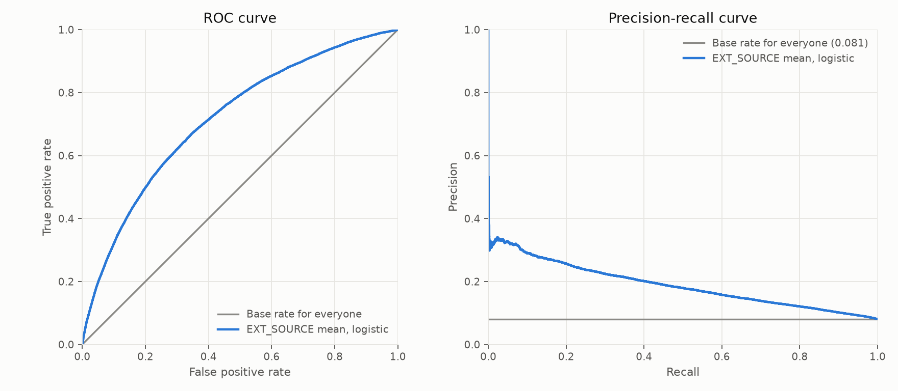
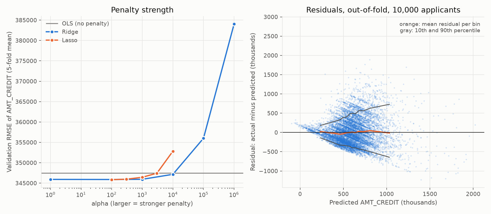
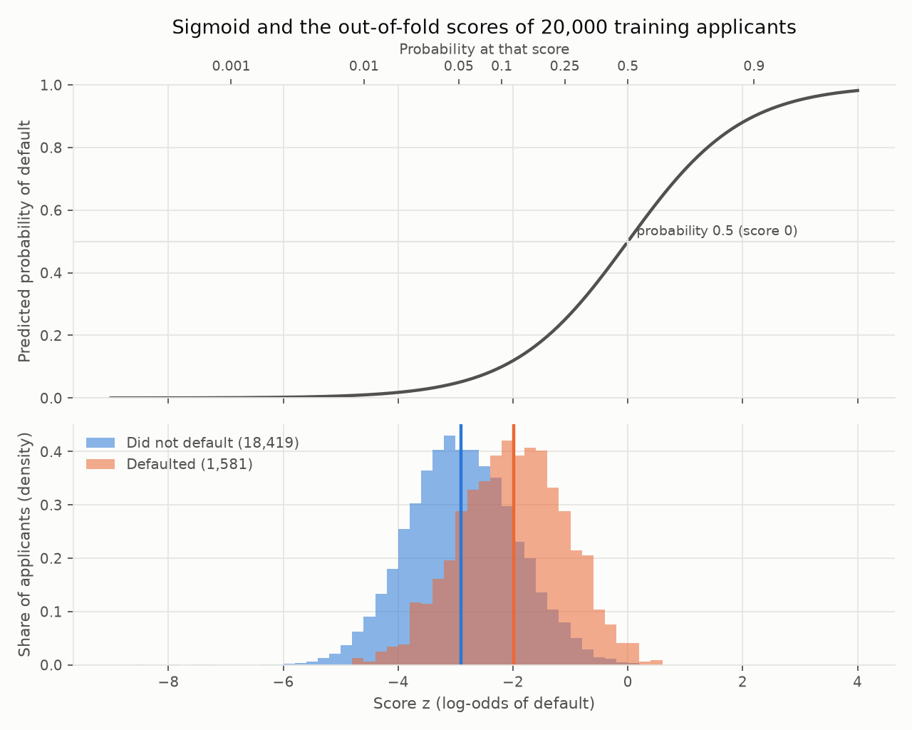
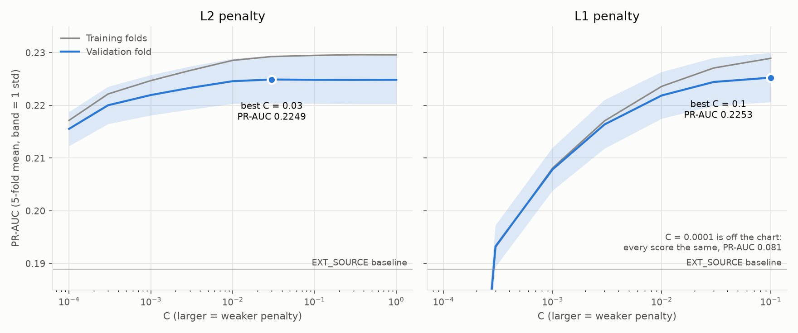
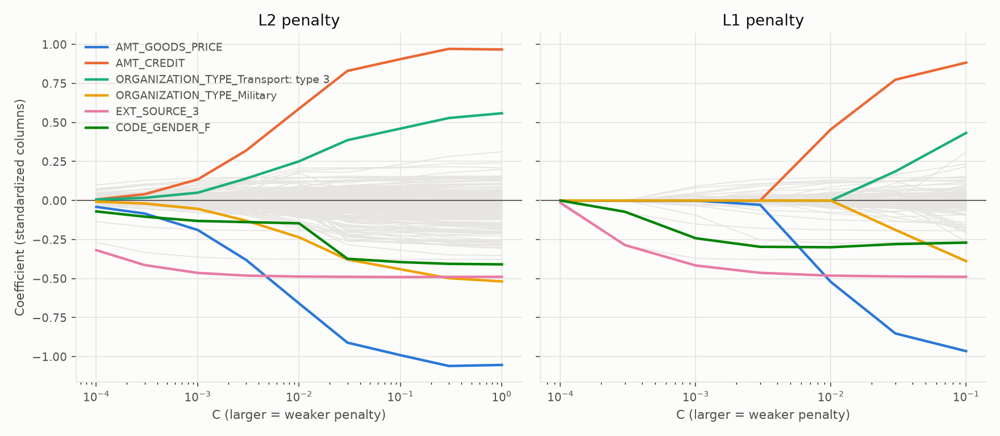
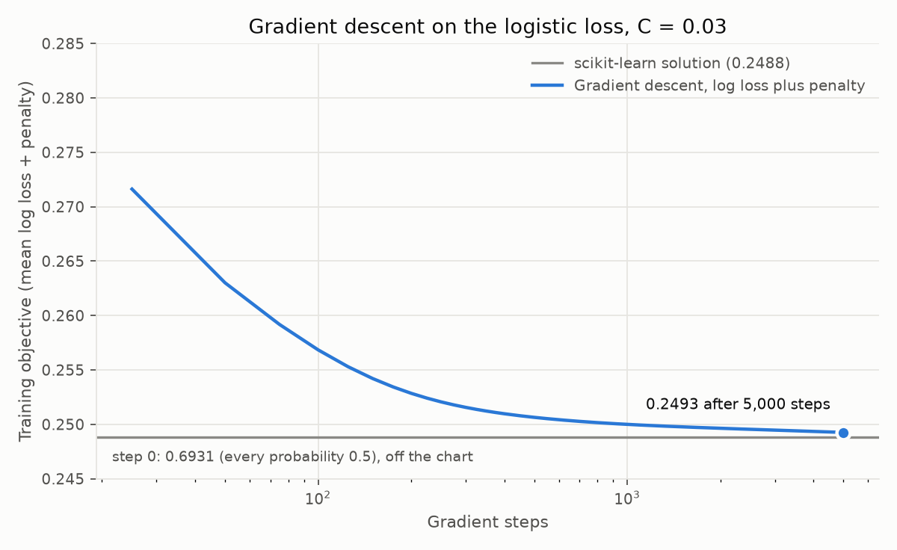
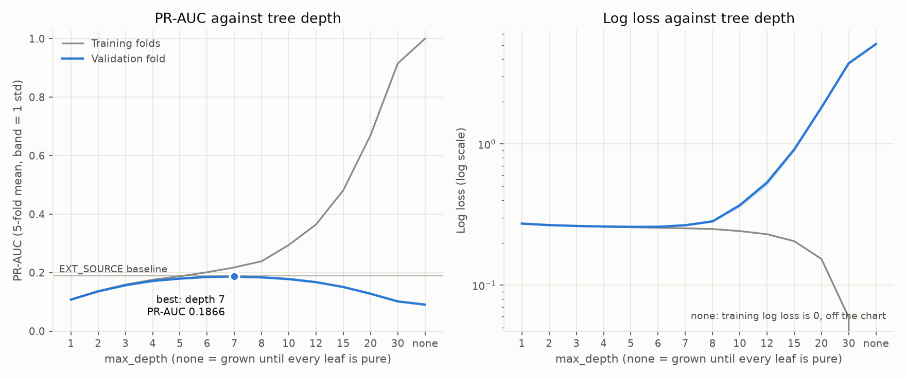

# Math

Notation. Applicant $i = 1, \dots, n$ has a label $y_i \in \{0, 1\}$ (1 = default) and a predicted probability $\hat p_i$. $P = \sum_i y_i$ is the number of defaulters, $N = n - P$ the number of non-defaulters, and $\pi = P / n$ the base rate. In `application_train`, $\pi = 24{,}825 / 307{,}511 = 0.0807$.

## Evaluation metrics

All metrics are computed by `src/evaluate.py`, written with NumPy and checked against scikit-learn and against the worked example below (`tests/test_evaluate.py`).

### Counts at a threshold

Flag every applicant with $\hat p_i \ge t$:

$$
TP(t) = \sum_i \mathbf{1}[\hat p_i \ge t,\ y_i = 1], \qquad
FP(t) = \sum_i \mathbf{1}[\hat p_i \ge t,\ y_i = 0]
$$

$$
\text{precision}(t) = \frac{TP(t)}{TP(t) + FP(t)}, \qquad
\text{recall}(t) = \frac{TP(t)}{P}
$$

Precision is set to 0 when nobody is flagged.

### ROC-AUC

$$
\text{TPR}(t) = \frac{TP(t)}{P}, \qquad \text{FPR}(t) = \frac{FP(t)}{N}
$$

ROC-AUC is the area under TPR plotted against FPR, by the trapezoid rule over the distinct scores. It equals the probability that a random defaulter gets a higher score than a random non-defaulter, counting a tie as one half:

$$
\text{ROC-AUC} = \Pr(\hat p_{+} > \hat p_{-}) + \tfrac{1}{2}\Pr(\hat p_{+} = \hat p_{-})
$$

It does not depend on the base rate. A random ranking gives 0.5.

### PR-AUC (average precision)

Sort the distinct scores $t_1 > t_2 > \dots > t_K$ and write $R_k = \text{recall}(t_k)$, $P_k = \text{precision}(t_k)$, $R_0 = 0$:

$$
\text{PR-AUC} = \sum_{k=1}^{K} (R_k - R_{k-1})\, P_k
$$

This is a step sum, not a trapezoid. A random ranking gives $\pi = 0.0807$, so PR-AUC is read against that floor and not against 0.5. It is the main metric here because it ignores the 92% of applicants who do not default and are easy to rank.

### Log loss

$$
\text{log loss} = -\frac{1}{n} \sum_{i=1}^{n} \Big[ y_i \ln \hat p_i + (1 - y_i) \ln (1 - \hat p_i) \Big]
$$

with $\hat p_i$ clipped to $[10^{-15},\ 1 - 10^{-15}]$. A certain wrong answer then costs $-\ln 10^{-15} = 34.5$ instead of infinity.

### Predicting the base rate for everyone

With $\hat p_i = \pi$ for all $i$ there is one distinct score. At that threshold every applicant is flagged, so $TP = P$, $FP = N$, precision $= \pi$ and recall $= 1$:

$$
\text{PR-AUC} = (1 - 0)\,\pi = \pi, \qquad \text{ROC-AUC} = \tfrac{1}{2}, \qquad
\text{log loss} = -\pi \ln \pi - (1 - \pi)\ln(1 - \pi)
$$

At $\pi = 0.0807$ the log loss is 0.2805.

### Worked example

Six applicants, highest score first:

| Applicant | $\hat p$ | $y$ |
|---|---|---|
| A | 0.9 | 1 |
| B | 0.8 | 1 |
| C | 0.7 | 0 |
| D | 0.6 | 1 |
| E | 0.4 | 0 |
| F | 0.2 | 0 |

- ROC-AUC: the defaulter scores higher in 3 + 3 + 2 = 8 of the 9 defaulter and non-defaulter pairs, so $8/9 = 0.8889$.
- PR-AUC: precision is 1, 1, 2/3, 3/4 at the thresholds where recall is 1/3, 2/3, 2/3, 1, so $\tfrac13 \cdot 1 + \tfrac13 \cdot 1 + 0 + \tfrac13 \cdot \tfrac34 = 11/12 = 0.9167$.
- Log loss: $-\tfrac{1}{6}(\ln 0.9 + \ln 0.8 + \ln 0.3 + \ln 0.6 + \ln 0.6 + \ln 0.8) = 0.4629$.
- At $t = 0.5$ the flagged are A, B, C, D, so precision is $3/4$ and recall is $3/3$.

## Baselines

Two models set the floor. The base-rate model predicts $\hat p_i = \pi$ for everyone. The second model is a logistic regression on one feature, the mean of the available values among `EXT_SOURCE_1`, `EXT_SOURCE_2` and `EXT_SOURCE_3`:

$$
\hat p_i = \sigma(\beta_0 + \beta_1 x_i), \qquad \sigma(z) = \frac{1}{1 + e^{-z}}
$$

The 172 applicants with none of the three scores get the median, fitted on the training fold only.

Scores are 5-fold stratified cross-validation on the 246,008 training applicants (seed 42), mean over folds with the standard deviation in brackets. The holdout is not used.

| Model | PR-AUC | ROC-AUC | Log loss |
|---|---|---|---|
| Base rate for everyone | 0.0807 | 0.5000 | 0.2805 |
| `EXT_SOURCE` mean, logistic | 0.1889 (0.0021) | 0.7164 (0.0025) | 0.2577 (0.0004) |

The curves pool the out-of-fold predictions of the 5 folds. The base-rate model is the diagonal on the ROC curve and the horizontal line at $\pi$ on the precision-recall curve.

The one-feature model lifts PR-AUC to 2.3 times the base rate and lowers log loss from 0.2805 to 0.2577. Its precision falls from about 0.3 near the top of the ranking to 0.08 at full recall. Every later model is compared with these two rows.

## Linear regression and squared loss

Side problem: predict the loan amount `AMT_CREDIT` from the applicant's other application columns. `AMT_GOODS_PRICE` (correlation 0.987 with `AMT_CREDIT`) and `AMT_ANNUITY` are left out because they are near copies of the target. Columns are preprocessed as for the default model, with 117 raw columns becoming about 300 after encoding. Scores are 5-fold cross-validation on the 246,008 training applicants (`src/linear_regression.py`).

### Model and loss

With a design matrix $X$ ($n$ rows, a leading column of ones for the intercept), targets $y$ and weights $w$:

$$
\hat y = X w, \qquad
L(w) = \frac{1}{n} \sum_{i=1}^{n} (y_i - \hat y_i)^2 = \frac{1}{n} \lVert y - X w \rVert_2^2
$$

The gradient is

$$
\nabla_w L = -\frac{2}{n} X^\top (y - X w)
$$

Setting it to zero gives the normal equation

$$
X^\top X\, \hat w = X^\top y \quad\Longrightarrow\quad \hat w = (X^\top X)^{-1} X^\top y
$$

At the solution $X^\top (y - X\hat w) = 0$: the residuals sum to zero and are uncorrelated with every column. `tests/test_linear_regression.py` checks the closed form against scikit-learn and checks this orthogonality.

Metrics: $\text{RMSE} = \sqrt{L(\hat w)}$, $\text{MAE} = \frac{1}{n}\sum_i \lvert y_i - \hat y_i \rvert$ and

$$
R^2 = 1 - \frac{\sum_i (y_i - \hat y_i)^2}{\sum_i (y_i - \bar y)^2}
$$

so $R^2 = 0$ is the score of predicting the mean $\bar y$ for everyone and negative values are worse than that.

### Ridge and lasso

Ridge adds the squared size of the weights (the intercept is not penalized):

$$
\hat w_{\text{ridge}} = \arg\min_w \; \lVert y - X w \rVert_2^2 + \alpha \lVert w \rVert_2^2
\quad\Longrightarrow\quad
\hat w_{\text{ridge}} = (X^\top X + \alpha I)^{-1} X^\top y \quad \text{(centered columns)}
$$

Lasso adds the absolute size, which has no closed form and sets weights exactly to zero:

$$
\hat w_{\text{lasso}} = \arg\min_w \; \frac{1}{2n} \lVert y - X w \rVert_2^2 + \alpha \lVert w \rVert_1
$$

scikit-learn's two $\alpha$ are on different scales, since ridge uses the sum of squares and lasso the mean. The same grid cannot be used for both. The ridge closed form is in `src/linear_regression.py` and matches scikit-learn's `Ridge` to 6 digits in the tests, for $\alpha$ from 0 to $10^4$.

### Results

| Model | RMSE | MAE | $R^2$ |
|---|---|---|---|
| Predict the mean for everyone | 402,725 | | 0 |
| OLS, no clipping | 419,414 (fold std 124,402) | 279,489 | -0.16 |
| OLS, clipped | 347,500 (3,006) | 266,269 | 0.255 |
| Ridge, clipped, $\alpha = 100$ | 345,891 (956) | 266,152 | 0.262 |
| Lasso, clipped, $\alpha = 100$ | 345,856 (998) | 266,094 | 0.263 |

- **One applicant breaks the unclipped fit.** A single validation applicant has an income of 117,000,000 (1,066 standard deviations above the mean). The model multiplies it by its income weight and predicts a loan of 119.9 million for an actual 562,491. That one squared error is about 70% of the fold's total, which gives that fold an RMSE of 641,945 against about 363,000 in the other four. MAE hardly moves (272,373 against 280,000 to 282,000) because it grows linearly with the error and not with its square.
- **Clipping fixes it.** Every numeric column with more than two distinct values is capped at the 0.1th and 99.9th percentile of the training fold. Binary flags are left alone, since a flag set for 2 applicants would otherwise be clipped away. RMSE falls to 347,500 on every fold and $R^2$ rises to 0.255, because the extreme values also distorted the weights for all other applicants.
- **With clipping the penalty helps slightly.** Ridge and lasso at $\alpha = 100$ improve RMSE by about 1,600 over OLS, more than the fold spread of about 1,000. Lasso at $\alpha = 100$ keeps 181 of 296 columns for the same score. Large penalties hurt: ridge at $\alpha = 10^6$ gives RMSE 384,053.
- **Residuals.** In 12 bins of predicted amount the mean residual stays within about 46,000 of 0, small against the spread, so the fit is not biased. The spread grows with the predicted amount: the 10th to 90th percentile of the residual is -140,000 to +181,000 around a prediction of 234,000 and -644,000 to +731,000 around 1,031,000. The diagonal stripes are loan amounts that repeat (round figures). 14 of the 10,000 plotted predictions are negative.
- The profile of an applicant explains only 26% of the variance of the loan amount.

## Logistic regression

The default model: a linear score turned into a probability. The preprocessed training table has $n = 246{,}008$ rows and $d = 301$ columns (`src/preprocess.py`, standardized). Cross-validation results are in `results/logistic.csv` and `results/regularization_curve.csv`.

### Model

For applicant $i$ with column vector $x_i$, weights $w$ and intercept $b$:

$$
z_i = b + x_i^\top w, \qquad \hat p_i = \sigma(z_i) = \frac{1}{1 + e^{-z_i}}, \qquad
\ln \frac{\hat p_i}{1 - \hat p_i} = z_i
$$

The score $z_i$ is the log-odds of default. $\sigma$ maps it into $(0, 1)$, with $\sigma(0) = 0.5$, $\sigma(-z) = 1 - \sigma(z)$ and $\sigma'(z) = \sigma(z)\,(1 - \sigma(z))$. Increasing a standardized column by one standard deviation multiplies the odds of default by $e^{w_j}$: with the fitted weights of the chosen model, $e^{-0.489} = 0.61$ for `EXT_SOURCE_3` and $e^{-0.376} = 0.69$ for `EXT_SOURCE_2`.

The real scores sit on the flat lower part of the curve. The median score is -2.90 for applicants who did not default and -1.99 for those who did, a difference of 0.91 log-odds (odds 2.5 times higher). The two distributions overlap heavily, which is what a ROC-AUC of 0.75 looks like. Only 0.17% of applicants have a score above 0 (probability above 0.5), so a threshold of 0.5 would flag almost nobody.

### Loss and gradient

The weights maximize the Bernoulli likelihood of the labels, which is the same as minimizing the log loss of the evaluation section:

$$
L(b, w) = \frac{1}{n} \sum_{i=1}^{n} \ell_i, \qquad
\ell_i = -y_i \ln \hat p_i - (1 - y_i) \ln (1 - \hat p_i)
$$

Since $\sigma' = \sigma(1 - \sigma)$, the derivative with respect to the score is

$$
\frac{\partial \ell_i}{\partial z_i} = -y_i (1 - \hat p_i) + (1 - y_i)\,\hat p_i = \hat p_i - y_i
$$

and the chain rule through $z_i = b + x_i^\top w$ gives

$$
\nabla_w L = \frac{1}{n} X^\top (\hat p - y), \qquad
\frac{\partial L}{\partial b} = \frac{1}{n} \sum_{i=1}^{n} (\hat p_i - y_i)
$$

This has the same form as the squared-loss gradient $-\tfrac{2}{n} X^\top (y - \hat y)$: a column's weight moves in proportion to how that column correlates with the miss. The Hessian is $\tfrac{1}{n} X^\top \mathrm{diag}\big(\hat p_i (1 - \hat p_i)\big) X$, which is positive semi-definite, so $L$ is convex and has no local minima apart from the global one. At $w = 0$, $b = 0$ every probability is 0.5 and $L = \ln 2 = 0.6931$. `tests/test_logistic_math.py` checks the gradient against finite differences and on a two-applicant example worked out by hand.

### Regularization

scikit-learn minimizes, with the intercept left out of the penalty,

$$
\min_{b, w}\; C \sum_{i=1}^{n} \ell_i + \tfrac{1}{2} \lVert w \rVert_2^2 \quad (\text{L2}),
\qquad
\min_{b, w}\; C \sum_{i=1}^{n} \ell_i + \lVert w \rVert_1 \quad (\text{L1})
$$

Dividing by $C n$ puts it on the scale of the mean loss, with penalty weight $\lambda = 1 / (C n)$:

$$
\frac{1}{n} \sum_i \ell_i + \frac{\lambda}{2} \lVert w \rVert_2^2, \qquad
\nabla_w = \frac{1}{n} X^\top (\hat p - y) + \lambda w
$$

The L1 term adds $\lambda\,\mathrm{sign}(w_j)$ to the gradient of weight $j$ and sets weights that do not earn their place exactly to zero. A small $C$ is a large $\lambda$. For the chosen $C = 0.03$ and $n = 246{,}008$, $\lambda = 1.355 \times 10^{-4}$.

Cross-validated PR-AUC against $C$ is flat above $C = 0.01$ for L2 and the training and validation curves are 0.0044 apart at $C = 0.03$, so the model does not overfit. Weights of near-duplicate columns (`AMT_CREDIT` and `AMT_GOODS_PRICE`, correlation 0.987) take large opposite values that cancel.

In the path chart, the L1 panel stops at $C = 0.1$ because a single L1 fit at $C = 1$ took 381 s with `liblinear`.

### Learning: gradient descent

Gradient descent repeats $w \leftarrow w - \eta\,\nabla_w$ and $b \leftarrow b - \eta\,\partial L / \partial b$. The step size $\eta = 1 / (\tfrac{1}{4}\lambda_{\max}(X^\top X / n) + \lambda)$ is the reciprocal of a bound on the curvature, and is 0.0986 here ($\lambda_{\max} = 39.6$). `src/logistic_math.py` implements the loss, the gradient and this loop in a few lines, and `src/logistic_demo.py` runs it on the real training table.

- The objective falls from 0.6931 to 0.2716 after 25 steps, 0.2500 after 1,000 and 0.2493 after 5,000, against 0.2488 for scikit-learn's solution (gap 0.00045).
- The predicted probabilities of the two solutions have a correlation of 0.993, but the weights only 0.88. Near-duplicate columns form a flat valley in which many weight vectors have almost the same loss, and plain gradient descent moves along it slowly. scikit-learn's L-BFGS uses curvature and needed about 100 to 150 iterations at $C$ from 0.01 to 1.
- On small problems (`tests/test_logistic_math.py`, 20,000 steps) the hand-written loop reaches scikit-learn's weights to within 0.002.

### Results

5-fold stratified cross-validation on the 246,008 training applicants, mean (standard deviation over folds):

| Model | PR-AUC | ROC-AUC | Log loss |
|---|---|---|---|
| Base rate for everyone | 0.0807 | 0.5000 | 0.2805 |
| `EXT_SOURCE` mean, logistic | 0.1889 (0.0021) | 0.7164 (0.0025) | 0.2577 (0.0004) |
| Logistic regression, all columns, L2, $C = 0.03$ | 0.2249 (0.0045) | 0.7475 (0.0012) | 0.2495 (0.0003) |

The holdout is not used yet.

## Decision tree

A decision tree splits the applicants with a yes/no question on one column, repeats inside each part, and predicts for a leaf the share of defaulters among the training applicants in it. Preprocessing is the same pipeline as for the linear models, without scaling. The settings are scikit-learn's defaults except `max_depth`, with the Gini criterion and no minimum leaf size.

### Depth and overfitting

`max_depth` from 1 to 30 and with no limit, 5-fold stratified cross-validation on the 246,008 training applicants. Mean over folds, validation fold:

| `max_depth` | Leaves | PR-AUC | ROC-AUC | Log loss |
|---:|---:|---:|---:|---:|
| 1 | 2 | 0.1076 | 0.5869 | 0.2732 |
| 3 | 8 | 0.1566 | 0.6826 | 0.2629 |
| 5 | 32 | 0.1794 | 0.7059 | 0.2590 |
| 7 | 122 | 0.1866 | 0.7138 | 0.2659 |
| 10 | 572 | 0.1779 | 0.7044 | 0.3680 |
| 15 | 2,537 | 0.1507 | 0.6556 | 0.9148 |
| 30 | 11,870 | 0.1014 | 0.5173 | 3.7271 |
| none (depth 56 to 63) | 15,993 | 0.0904 | 0.5374 | 5.1014 |

- Validation PR-AUC peaks at depth 7 (0.1866, std 0.0053 over folds) and falls from there, while the training PR-AUC rises to 1.0 for the unlimited tree.
- Log loss is best at depth 5 (0.2590) and is worse than the 0.2805 of predicting the base rate from depth 8 on (0.2834), because a deep tree gives leaves with a few applicants probabilities close to 0 or 1.
- The best tree is below the logistic regression (PR-AUC 0.2249) and just below the `EXT_SOURCE` mean baseline (0.1889).
