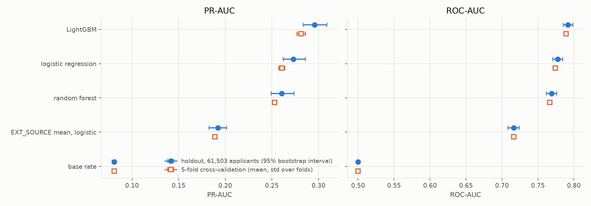
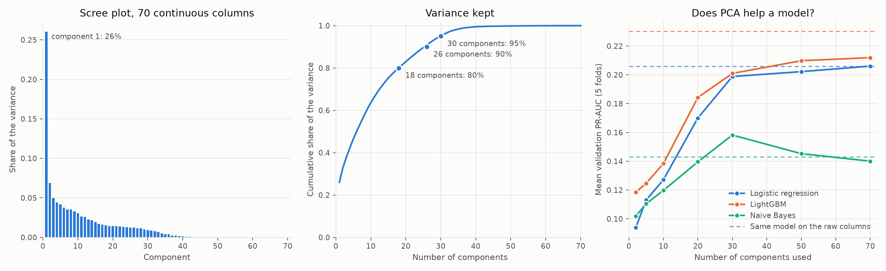
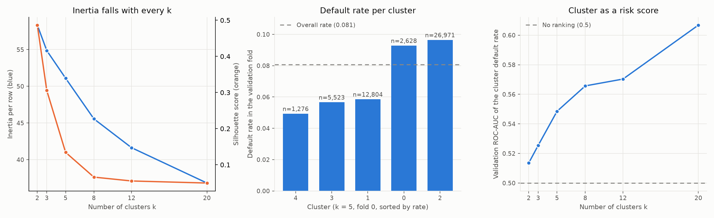
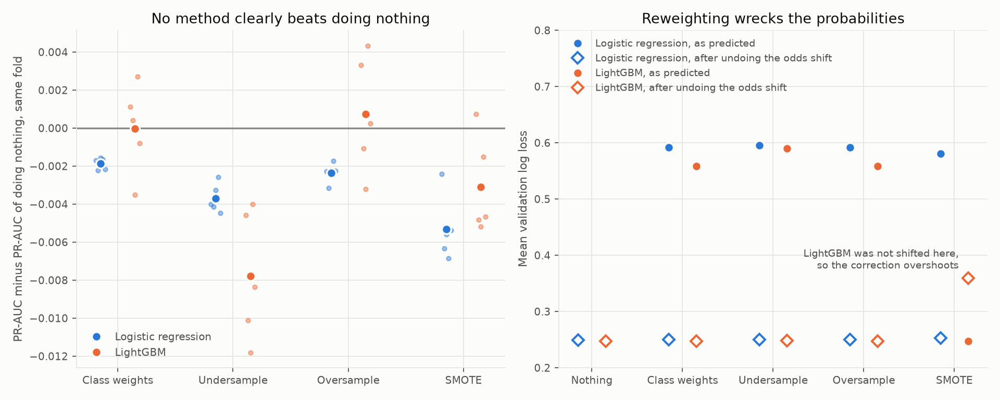
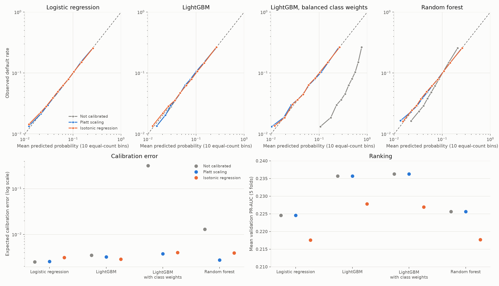
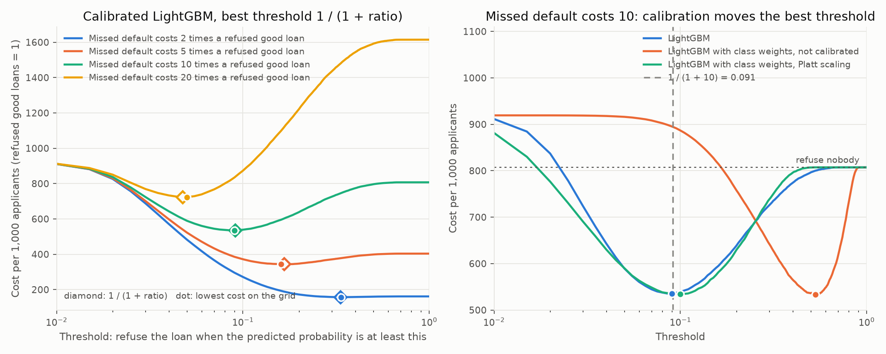
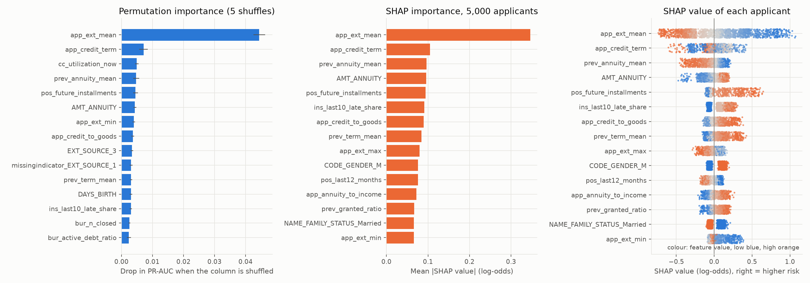
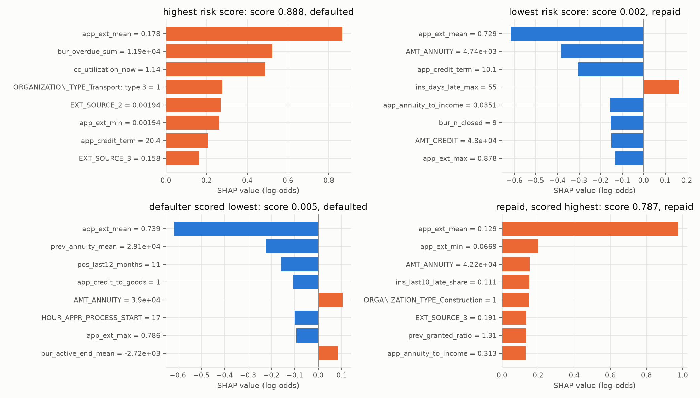
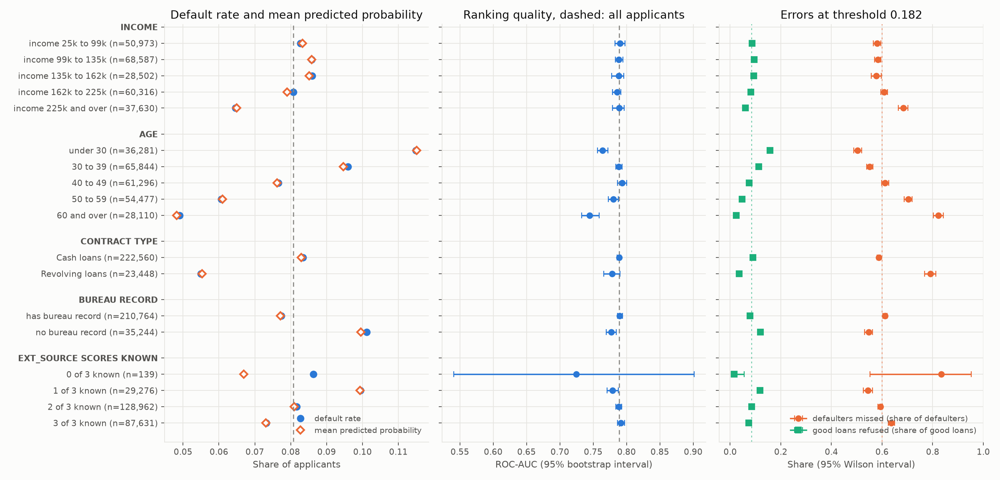
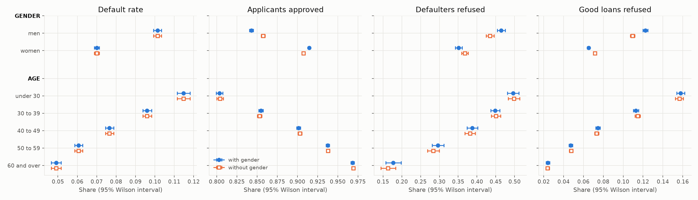

# Credit Risk Prediction

Loan default prediction on the Home Credit Default Risk data (307,511 applications, 8.1% default). Classic machine learning algorithms (linear models, trees, boosting and more) are compared with the same metrics and the same cross-validation, with features built in SQL, and then explained, checked for where they fail and for fairness, and scored once on a holdout. The aim is to understand each algorithm: its loss, how it learns and where it fails.

## Results at a glance

The best model is LightGBM with tuned settings on the application columns plus 106 columns built in SQL from the other six tables. Scored once on 61,503 holdout applicants (95% bootstrap intervals):

| Model | PR-AUC | ROC-AUC | Log loss |
|---|---:|---:|---:|
| LightGBM, tuned | 0.2957 (0.2835 to 0.3089) | 0.7918 (0.7852 to 0.7986) | 0.2347 |
| Logistic regression | 0.2731 (0.2622 to 0.2860) | 0.7775 (0.7707 to 0.7845) | 0.2398 |
| Random forest | 0.2605 (0.2491 to 0.2735) | 0.7690 (0.7617 to 0.7762) | 0.2440 |
| One-feature logistic (`EXT_SOURCE` mean) | 0.1921 (0.1825 to 0.2014) | 0.7165 (0.7083 to 0.7241) | 0.2574 |
| Base rate for everyone | 0.0807 (0.0787 to 0.0828) | 0.5000 | 0.2805 |



- Most of the gain came from the features: the SQL feature groups raised LightGBM from 0.2385 to 0.2756 PR-AUC in cross-validation, in 5 of 5 folds. Tuning added 0.006, and class weights, resampling and calibration added nothing to the ranking.
- The model is calibrated overall and in every segment of 1,000 applicants or more, but it ranks worse for applicants aged 60 and over and under 30, and its error rates differ between men and women and between age groups.
- Under an assumed cost (a missed default loses 45% of the loan, a refused good loan a 10% margin) the threshold 0.182 costs 18.0% (16.3% to 19.6%) less on the holdout than approving everybody. The cost figures are assumptions, not data.
- Every model scores higher on the holdout than in cross-validation, and the reason was not isolated.

## Documents

| File | Content |
|---|---|
| `results.md` | The full write-up: every result with its interval, what did not work, what is not established |
| `MATH.md` | The maths of each algorithm and metric, each checked by a test, with charts made from this project's results |
| `MODEL_CARD.md` | Intended use, data, metrics, limits and fairness findings of the final model |
| `demo.ipynb` | The whole story in one notebook, run from the files in `results/` and `docs/img/` only (no data, no database, about 20 seconds) |
| this file | Results at a glance, setup, how to run, and the results of each stage |

## Project layout

```
src/        one script per stage (loading, features, models, tuning, explanation, holdout, tracking, charts)
sql/        one SQL file per feature group
tests/      pytest checks of the metrics, the split, the SQL tables, the maths and the holdout guard
results/    the numbers behind every table and chart (CSV); row-level samples are kept on disk only, not in git
docs/img/   the charts used in this file and in MATH.md
data/       the raw files, the SQLite database and caches of out-of-fold predictions (not tracked)
```

## Setup and how to run

Python 3.12. From the project root:

```
python -m venv .venv
.venv/bin/pip install -r requirements.txt
export PYTHONPATH=src
```

The Kaggle files are not in the repository. Accept the rules of the competition `home-credit-default-risk`, download the files into `data/raw/` and run the stages in this order. The numbers in `results/` are committed, so a stage only needs rerunning to reproduce it; times are for a 16-core machine:

| Step | Command | What it does |
|---|---|---|
| 1 | `python src/load.py` | Loads the 7 tables into `data/home_credit.db` |
| 2 | `python src/split.py` | Stratified 80/20 split into training and holdout, fixed seed |
| 3 | `python src/features.py` | Builds the six SQL feature tables (the 13.6 million row table needs a large SQLite page cache, set in the script) |
| 4 | `python src/baselines.py`, `logistic.py`, `regularization.py`, `linear_regression.py` | Baselines, logistic regression, ridge and lasso, the loan-amount side study |
| 5 | `python src/tree.py`, `forest.py`, `boosting.py`, `xgboosting.py` | Trees, forest and the two boosting libraries |
| 6 | `python src/tuning.py` | 60 Optuna trials (about 24 minutes); `python src/tuning.py track` also logs each trial to MLflow |
| 7 | `python src/feature_gain.py` | Each SQL feature group added to the application columns, for LightGBM and logistic regression |
| 8 | `python src/knn_svm.py`, `naive_bayes.py`, `pca.py`, `kmeans.py` | The other algorithms |
| 9 | `python src/imbalance.py`, `calibration.py`, `threshold.py` | Class weights and resampling, calibration, the cost threshold |
| 10 | `python src/explain.py`, `segments.py`, `fairness.py` | SHAP and permutation importance, errors by segment, the fairness check (`segments.py` and `fairness.py` each fit the model on 5 folds, about 10 minutes) |
| 11 | `python src/forest_sql.py`, then `python src/holdout.py` | The forest check on the SQL features, then the holdout score. `holdout.py` refuses to run again while `results/holdout.csv` exists |
| 12 | `python src/tracking.py backfill`, then `python src/tracking.py final` | The tuning study and the final model into MLflow |
| 13 | `python src/make_plots.py` | Every chart in `docs/img/` from the files in `results/`. The charts of the SHAP values, the SVM margins and the class-weight shift also need the row-level files written by `explain.py`, `svm_math.py` and `weighted_math.py`, which are not in the repository |

The maths checks have their own scripts (`logistic_demo.py`, `tree_math.py`, `forest_math.py`, `boosting_math.py`, `knn_math.py`, `svm_math.py`, `pca_math.py`, `kmeans_math.py`, `weighted_math.py`, with `python src/weighted_math.py gap` for the odds-shift study). Tests: `python -m pytest tests` (399 tests; `tests/test_sql_features.py` needs the database and the feature tables). To browse the MLflow runs: `mlflow ui --backend-store-uri sqlite:///mlflow.db`.

## Data

Home Credit Default Risk, downloaded from Kaggle into `data/raw/` (not tracked).

| Table | Rows | Size |
|---|---:|---:|
| `application_train` | 307,511 | 166 MB |
| `application_test` | 48,744 | 27 MB |
| `bureau` | 1,716,428 | 170 MB |
| `bureau_balance` | 27,299,925 | 376 MB |
| `previous_application` | 1,670,214 | 405 MB |
| `POS_CASH_balance` | 10,001,358 | 393 MB |
| `installments_payments` | 13,605,401 | 723 MB |
| `credit_card_balance` | 3,840,312 | 425 MB |

## Features from SQL

`sql/` holds one file per feature group. `src/features.py` builds each into a `feat_*` table with one row for each of the 307,511 applicants and checks that count. `src/feature_gain.py` adds one group at a time to the application columns and scores it with the same 5-fold cross-validation (PR-AUC, results in `results/feature_gain.csv`).

| Group | Columns | LightGBM PR-AUC gain | Logistic PR-AUC gain |
|---|---:|---:|---:|
| bureau, with `bureau_balance` | 25 | +0.0110 | +0.0088 |
| previous_application | 23 | +0.0107 | +0.0120 |
| POS_CASH_balance | 13 | +0.0094 | +0.0069 |
| installments_payments | 14 | +0.0104 | +0.0086 |
| credit_card_balance | 17 | +0.0068 | +0.0074 |
| application ratios | 14 | +0.0083 | +0.0036 |
| all six | 106 | +0.0371 | +0.0356 |

Base PR-AUC is 0.2385 for LightGBM and 0.2250 for logistic regression. With all six groups it is 0.2756 and 0.2606, and 0.2813 for LightGBM with the tuned parameters. Every group improves PR-AUC in all 5 folds.

Build the tables from the project root with `PYTHONPATH=src python src/features.py`. SQLite needs a large page cache for the 10 and 13.6 million row tables (set in `build_all`): the POS_CASH build took 72 s with it and did not finish in 55 minutes without it.

## kNN and SVM

`src/knn_svm.py` fits kNN, an RBF SVM and logistic regression on stratified subsamples of each training fold (2,000 to 20,000 rows of about 197,000) and scores them on the whole validation fold, base application columns only. PR-AUC, mean of 5 folds:

| Training rows | kNN (k = 500) | SVM (balanced weights) | Logistic | SVM fit time | Logistic fit time |
|---:|---:|---:|---:|---:|---:|
| 2,000 | 0.1321 | 0.1779 | 0.1706 | 0.7 s | 0.5 s |
| 5,000 | 0.1501 | 0.1978 | 0.1951 | 5.1 s | 1.1 s |
| 10,000 | 0.1593 | 0.2069 | 0.2061 | 20.4 s | 1.4 s |
| 20,000 | 0.1698 | 0.2123 | 0.2139 | 84.7 s | 2.1 s |

kNN is behind logistic regression in every fold at every size. The SVM is level with logistic regression from 5,000 rows up, with a fit time that grows 119 times for 10 times the rows. Without class weights the SVM scores 0.114 at 5,000 rows. kNN on only the three `EXT_SOURCE` columns scores 0.1915 against 0.1698 on all columns. Results in `results/knn_svm.csv` and `results/knn_ext.csv`.

## Naive Bayes

`src/naive_bayes.py` fits `GaussianNB` on the 246,008 training rows with the same 5 folds. `var_smoothing` is chosen by cross-validation and a sigmoid calibration follows. PR-AUC, mean of 5 folds (base rate 0.0807, one-feature logistic baseline 0.1889):

| Columns | Default `var_smoothing` | Best `var_smoothing`, calibrated |
|---|---:|---:|
| all 300 | 0.0830 | 0.1461 |
| 70 continuous | 0.1431 | 0.1672 |
| 3 `EXT_SOURCE` | 0.1942 | 0.1971 |

With the defaults Naive Bayes gives 94.7% of applicants a probability above 0.5 (log loss 29.7). Dropping the 0/1 columns, flattening the likelihoods with a larger `var_smoothing` and calibrating repairs the probabilities, and more columns still make the ranking worse. Results in `results/naive_bayes.csv`.

## PCA

`src/pca.py` fits PCA on the 70 continuous application columns of each training fold and scores models on the top components. Chart in `docs/img/pca.png`.



The first component holds 26.0% of the variance and loads on the `_AVG`, `_MEDI` and `_MODE` copies of the housing columns. 18 components keep 80% of the variance, 26 keep 90% and 30 keep 95%. PR-AUC with 30 components against the raw 70 columns: logistic regression 0.1988 against 0.2061, LightGBM 0.2010 against 0.2303, Naive Bayes 0.1582 against 0.1431. PCA helps only Naive Bayes, whose columns it decorrelates. Results in `results/pca_variance.csv`, `results/pca_models.csv` and `results/pca_loadings.csv`.

## k-means

`src/kmeans.py` clusters the 70 continuous application columns of each training fold for k from 2 to 20, assigns the validation fold to the nearest centroid, and compares default rates per cluster. Chart in `docs/img/kmeans.png`.



The clusters do differ in default rate: at k = 5 the lowest and highest validation rates average 5.1% and 9.8% over the folds against 8.1% overall (chi-square p below 0.0001 at every k), and the gap widens with k, from 5.6% and 8.3% at k = 2 to 3.9% and 13.0% at k = 20. The applicants have no natural groups: the silhouette score is 0.49 at k = 2, where a small group of outliers splits off, 0.13 at k = 5 and 0.05 at k = 20, and inertia has no elbow. At k = 5 the clusters are described by loan size, by how much housing data the applicant has and by one cluster of 533 applicants with a bad `YEARS_BEGINEXPLUATATION` value. The cluster's default rate as a risk score gives ROC-AUC 0.549 at k = 5 and 0.607 at k = 20, against 0.5 for no ranking. Results in `results/kmeans_summary.csv`, `results/kmeans_clusters.csv` and `results/kmeans_profile.csv`.

## Class imbalance

`src/imbalance.py` compares doing nothing with balanced class weights, random undersampling, random oversampling and SMOTE (`imbalanced-learn`) for logistic regression and LightGBM (learning rate 0.05, defaults, early stopping on PR-AUC of a 10% part cut off before resampling). Resampling is applied to the training part of each fold only. Chart in `docs/img/imbalance.png`.



| Model | Method | PR-AUC | Difference from nothing (folds better) | Log loss | Log loss after the odds correction | Mean probability |
|---|---|---:|---:|---:|---:|---:|
| Logistic | nothing | 0.2250 | | 0.2495 | 0.2495 | 0.081 |
| Logistic | class weights | 0.2231 | -0.0019 (0 of 5) | 0.5919 | 0.2496 | 0.420 |
| Logistic | undersample | 0.2213 | -0.0037 (0 of 5) | 0.5951 | 0.2501 | 0.423 |
| Logistic | oversample | 0.2226 | -0.0024 (0 of 5) | 0.5918 | 0.2497 | 0.420 |
| Logistic | SMOTE | 0.2197 | -0.0053 (0 of 5) | 0.5809 | 0.2526 | 0.402 |
| LightGBM | nothing | 0.2386 | | 0.2470 | 0.2470 | 0.080 |
| LightGBM | class weights | 0.2386 | -0.0000 (3 of 5) | 0.5584 | 0.2475 | 0.401 |
| LightGBM | undersample | 0.2308 | -0.0078 (0 of 5) | 0.5902 | 0.2483 | 0.422 |
| LightGBM | oversample | 0.2393 | +0.0007 (3 of 5) | 0.5581 | 0.2474 | 0.401 |
| LightGBM | SMOTE | 0.2355 | -0.0031 (1 of 5) | 0.2475 | 0.3594 | 0.085 |

No method improves PR-AUC or ROC-AUC beyond fold-to-fold noise: the largest gain is +0.0007 (std 0.0031), and seven of the eight changes are zero or negative. Class weights and resampling raise the average predicted probability from 0.08 to about 0.40, put about a third of the applicants above 0.5 (0.2% when doing nothing) and more than double the log loss (from 0.25 to between 0.56 and 0.60). Multiplying the odds by the known factor (the true ratio of defaults to repaid loans, 0.088) gives the log loss back to within 0.0013 of doing nothing for every method except SMOTE on logistic regression (0.0031 higher). LightGBM on SMOTE rows is the exception: 99.8% of the synthetic rows have a non-0/1 value in one of the 230 binary columns, which no real applicant has, and its probabilities stay near the base rate (0.085), so the correction does not apply (0.3594). Undersampling is also the fastest for LightGBM (1.4 s against 4.8 s) and the weakest on PR-AUC. Results in `results/imbalance.csv`.

## Calibration

`src/calibration.py` fits each model on 80% of every training fold, fits a calibrator on the other 20%, and scores the validation fold. Platt scaling is a logistic regression on the log-odds of the predicted probability. Isotonic regression is a non-decreasing step function. The calibration curve pools the 5 validation folds into 10 equal-count groups. Chart in `docs/img/calibration.png`.



| Model | Calibrator | Log loss | Brier | ECE | PR-AUC | Mean probability |
|---|---|---:|---:|---:|---:|---:|
| Logistic | none | 0.2496 | 0.0686 | 0.0025 | 0.2246 | 0.0808 |
| Logistic | Platt | 0.2496 | 0.0686 | 0.0026 | 0.2246 | 0.0805 |
| Logistic | isotonic | 0.2512 | 0.0687 | 0.0031 | 0.2175 | 0.0806 |
| LightGBM | none | 0.2477 | 0.0682 | 0.0035 | 0.2357 | 0.0802 |
| LightGBM | Platt | 0.2476 | 0.0682 | 0.0032 | 0.2357 | 0.0805 |
| LightGBM | isotonic | 0.2491 | 0.0682 | 0.0029 | 0.2278 | 0.0805 |
| LightGBM, class weights | none | 0.5584 | 0.1901 | 0.3205 | 0.2363 | 0.4013 |
| LightGBM, class weights | Platt | 0.2475 | 0.0682 | 0.0038 | 0.2363 | 0.0806 |
| LightGBM, class weights | isotonic | 0.2488 | 0.0682 | 0.0040 | 0.2269 | 0.0805 |
| Forest | none | 0.2518 | 0.0691 | 0.0129 | 0.2256 | 0.0812 |
| Forest | Platt | 0.2501 | 0.0687 | 0.0027 | 0.2256 | 0.0806 |
| Forest | isotonic | 0.2517 | 0.0687 | 0.0039 | 0.2177 | 0.0807 |

Logistic regression and LightGBM trained on log loss are already calibrated, and neither calibrator improves them (the log loss changes by at most 0.0001 with Platt scaling). The random forest, with 200 trees, 30 columns per split and `min_samples_leaf` = 30, is too high for low-risk applicants and too low for the highest decile (0.209 predicted against 0.256 observed), and Platt scaling brings its ECE from 0.0129 to 0.0027 and its log loss from 0.2518 to 0.2501 (lower in 5 of 5 folds). LightGBM with balanced class weights keeps its ranking and its log loss goes from 0.5584 to 0.2475 with Platt scaling. Platt scaling keeps the order of the applicants, so it never changes PR-AUC or ROC-AUC. Isotonic regression reaches a similar calibration but lowers PR-AUC by 0.0070 to 0.0094 in every fold, because the steps make many applicants tie. Results in `results/calibration.csv` and `results/calibration_curve.csv`.

## Decision threshold

`src/threshold.py` turns the probabilities into refuse or accept from an assumed cost per loan: a missed default loses 45% of the credit amount (the Basel loss given default for unsecured loans) and a refused good loan loses a 10% margin on it. Both figures are assumptions. Both costs scale with the loan, so the best threshold is the same for every loan, $1 / (1 + 4.5)$ = 0.182, and the loan size only weights the totals. A flat ratio of 4.5 (every loan equal) and flat ratios of 2, 5, 10 and 20 are scored for comparison. Each fold's cost is scored with the threshold chosen on the other 4 folds (`cv_tuned`, the lowest cost on a grid of 0.005 steps) and with the fixed rules. LightGBM at its defaults, learning rate 0.05, trained on 80% of each training fold (the rest is the calibration part). Chart in `docs/img/threshold.png`.



Loan-size weighted cost per 1,000 applicants in units of one refused good loan of average size, a missed default costing 4.5, mean of 5 folds:

| Rule | Threshold | Cost | Applicants refused | Defaulters caught |
|---|---:|---:|---:|---:|
| Refuse nobody | | 337.9 | 0% | 0% |
| Fixed 0.5 | 0.5 | 334.4 | 0.2% | 1.5% |
| Fixed 0.1 | 0.1 | 334.5 | 25.2% | 58.6% |
| Threshold that maximises F1 | 0.143 | 305.6 | 14.9% | 42.7% |
| Tuned on the other 4 folds | 0.185 | 299.7 | 9.2% | 31.2% |
| 1 / (1 + r) | 0.182 | 300.1 | 9.6% | 31.9% |

- The formula and the tuned threshold have the same cost: the fold-by-fold difference is 0.45 (std 0.66) per 1,000 applicants, and the formula needs no tuning. The F1 threshold costs 1.8% more (higher in 5 of 5 folds).
- At this cost the model saves 11.2% over refusing nobody (300.1 against 337.9). With the earlier assumption of a flat ratio of 10 it saved 33.7% (535.4 against 807.3), so the cost assumption decides how much the model is worth.
- Weighting by loan size lowers the cost and leaves the threshold where it is: the flat ratio of 4.5 costs 317.0 at the formula's threshold and refusing nobody costs 363.3, against 337.9 weighted, because the defaulters took smaller loans (mean credit 557,477 against 603,014). The best threshold is 0.185 in both.
- The cost is an assumption and the threshold depends on it. On the loan-size weighted cost, a threshold chosen for a flat ratio of 2, 5, 10 or 20 costs 6.8%, 0.6%, 16.5% or 64.7% more than the best one. The flat ratio of 10 has its best threshold at 0.090 (535.2 per 1,000, formula 535.4).
- The formula needs calibrated probabilities. For LightGBM with balanced class weights the lowest cost is at 0.692 (300.3), near the 0.717 the odds shift of 11.4 predicts, and the formula's 0.182 refuses 83.8% of the applicants at a cost of 764.5. After Platt scaling the formula works again (300.2).
- A calibrated model predicts its own cost: the expected cost at the formula's threshold is 295.9 against a realised 300.1 (1.4% apart). For the class-weighted model the expected cost at its best threshold (1,445.7) is far from the realised one (300.3).
- The ratio of the two costs is the same for every loan (4.5), and the holdout is not used here. Results in `results/threshold_folds.csv` and `results/threshold_curve.csv`.

## Explainability

`src/explain.py` fits LightGBM with the tuned parameters on the six SQL feature groups (the best model by cross-validation, PR-AUC 0.2813) on the training part of fold 0, and explains it on that fold's 49,202 validation applicants. Fold 0 scores PR-AUC 0.2734, ROC-AUC 0.7898. The holdout is not used. Permutation importance shuffles one of the 477 model inputs at a time, 5 times, and measures the drop in PR-AUC. SHAP values (`TreeExplainer`, log-odds) are computed for 5,000 of the validation applicants. Charts in `docs/img/importance.png` and `docs/img/shap_applicants.png`, results in `results/permutation_importance.csv` and `results/shap_importance.csv`. The SHAP values of 2,000 applicants and of the four single applicants are written to `results/shap_sample.csv` and `results/shap_applicants.csv`, which are row-level and kept out of git.



| Feature | PR-AUC drop when shuffled (std over 5 shuffles) | Mean absolute SHAP value (log-odds) |
|---|---:|---:|
| `app_ext_mean` (mean of the three `EXT_SOURCE` scores) | 0.0444 (0.0019) | 0.346 |
| `app_credit_term` | 0.0071 (0.0014) | 0.105 |
| `prev_annuity_mean` | 0.0047 (0.0010) | 0.097 |
| `AMT_ANNUITY` | 0.0043 (0.0005) | 0.096 |
| `pos_future_installments` | 0.0045 (0.0008) | 0.094 |
| `ins_last10_late_share` | 0.0030 (0.0004) | 0.091 |

- One feature dominates. Shuffling `app_ext_mean` costs 0.044 PR-AUC, six times the next feature (`app_credit_term`, 0.007), and its mean absolute SHAP value is 3.3 times the next. A low outside score raises the predicted risk and a high one lowers it, from about -0.7 to +1.0 log-odds. The `EXT_SOURCE` columns and their aggregates together hold 16.7% of the total SHAP importance.
- The SQL features carry real weight: the six groups hold 62.6% of the SHAP importance (application ratios and `EXT_SOURCE` aggregates 21.4%, `previous_application` 11.6%, `bureau` 11.4%, `installments_payments` 7.7%, `POS_CASH_balance` 7.4%, `credit_card_balance` 3.1%) and the raw application columns 37.3%. 11 of the top 15 columns by permutation are SQL-built.
- The two measures agree on the top and differ below it. The rank correlation over all 477 columns is 0.59 and 15 of the top 20 columns are the same. The permutation drop is 0 or negative for 257 columns (87 are negative, which is noise around zero), and 144 columns have at least 0.1% of the SHAP importance. Correlated columns share the credit under both measures.
- Direction of the effects (rank correlation between the feature value and its SHAP value, 2,000 applicants): a higher `AMT_ANNUITY` (0.95), annuity-to-income (0.93), credit-to-goods ratio (0.90), `prev_granted_ratio` (0.88), `prev_term_mean` (0.86), late-instalment share (0.80) and number of future instalments (0.76) raise the predicted risk. A higher `app_ext_mean` (-0.99), `prev_annuity_mean` (-0.97), `pos_last12_months` (-0.92) and `app_ext_max` (-0.80) lower it. The credit term has no single direction (-0.28). `CODE_GENDER_M` raises the predicted risk by 0.106 log-odds on average for men and lowers it by 0.061 for women (2,000 applicants), so the model uses gender directly; the fairness check is a separate step.
- Single applicants (`docs/img/shap_applicants.png`): the highest score, 0.888 (defaulted), is driven by an `EXT_SOURCE` mean of 0.178 (+0.87 log-odds), overdue bureau debt (+0.52) and a credit card balance at 114% of its limit (+0.49). The lowest score, 0.002, comes from an `EXT_SOURCE` mean of 0.729 (-0.62) and a small annuity (-0.38). The defaulter scored lowest (0.005) has an `EXT_SOURCE` mean of 0.739 (-0.62), and the largest push upward is 0.10. The repaid applicant scored highest (0.787) has an `EXT_SOURCE` mean of 0.129 (+0.98).



## Where the model fails

`src/segments.py` scores the tuned LightGBM on the six SQL groups out of fold: each of the 246,008 training applicants is predicted by the model fitted without their fold, so every segment is large (the predictions are kept in `data/oof_best.parquet`, not tracked). Out of fold PR-AUC is 0.2809 and ROC-AUC 0.7891. Errors are counted at the threshold 0.182 from the loan-size cost (45% of the loan lost on a missed default, a 10% margin on a refused good loan): it misses 60.0% of the defaulters (interval 59.3% to 60.7%), refuses 8.4% of the good loans and 11.0% of all applicants, and costs 281.2 per 1,000 applicants against 337.9 for refusing nobody (16.8% less). Intervals are Wilson for the shares and a 200-resample bootstrap for the AUCs. Chart in `docs/img/segments.png`, results in `results/segments.csv`.



| Segment | Applicants | Default rate | ROC-AUC (95% interval) | Defaulters missed | Good loans refused | Cost saved against refusing nobody |
|---|---:|---:|---:|---:|---:|---:|
| All | 246,008 | 8.1% | 0.789 (0.786 to 0.792) | 60.0% | 8.4% | 16.8% |
| Income 25k to 99k | 50,973 | 8.3% | 0.790 (0.783 to 0.798) | 58.0% | 8.7% | 21.4% |
| Income 225k and over | 37,630 | 6.5% | 0.789 (0.779 to 0.796) | 68.3% | 6.0% | 10.4% |
| Age under 30 | 36,281 | 11.5% | 0.764 (0.756 to 0.772) | 50.4% | 15.8% | 22.4% |
| Age 40 to 49 | 61,296 | 7.7% | 0.793 (0.786 to 0.800) | 61.2% | 7.5% | 16.9% |
| Age 60 and over | 28,110 | 4.9% | 0.745 (0.733 to 0.759) | 82.3% | 2.4% | 7.5% |
| Cash loans | 222,560 | 8.3% | 0.789 (0.786 to 0.792) | 58.7% | 9.0% | 17.1% |
| Revolving loans | 23,448 | 5.5% | 0.778 (0.766 to 0.790) | 79.0% | 3.5% | 6.7% |
| No bureau record | 35,244 | 10.1% | 0.777 (0.769 to 0.785) | 54.7% | 12.0% | 20.9% |
| Has bureau record | 210,764 | 7.7% | 0.790 (0.786 to 0.794) | 61.2% | 7.9% | 16.0% |

- The model is calibrated in every segment of 1,000 applicants or more: the mean predicted probability is within 0.002 of the default rate in all 17.
- Most of the difference in error counts comes from the default rate, not from the ranking. Income bands 1 to 5 have ROC-AUC between 0.786 and 0.790 with overlapping intervals, yet the top band, with 6.5% defaulting, has 68.3% of its defaulters missed against 57.7% to 60.8% in the other bands, because one threshold refuses fewer applicants where fewer default. The loan-size cost saved falls from 21.4% in the lowest band to 10.4% in the top band.
- The model ranks worse for the oldest and the youngest applicants. ROC-AUC is 0.745 for 60 and over (1,379 defaulters) and 0.764 for under 30 (4,165 defaulters), against 0.793 for 40 to 49; the intervals do not overlap with the 30 to 49 groups. Under 30 the threshold refuses 19.7% of the applicants and 15.8% of the good loans. At 60 and over it refuses 3.2% and misses 82.3% of the defaulters, and the cost saved is 7.5%.
- Revolving loans gain little from the model (6.7% saved, 79.0% of defaulters missed), but their ROC-AUC (0.778, interval 0.766 to 0.790) is not clearly different from the overall 0.789; their default rate is 5.5%. Applicants without a bureau record rank worse (ROC-AUC 0.777 against 0.790, intervals not overlapping). They are 14.3% of the applicants and default at 10.1%.
- Applicants with fewer `EXT_SOURCE` scores known rank slightly worse: ROC-AUC 0.779 with one score known, 0.788 with two and 0.791 with three. Only 139 applicants have none (12 defaulters), too few to say anything: the AUC interval is 0.54 to 0.90 and the model predicts 6.7% against an observed 8.6%.
- The segments overlap (an applicant is in one income band, one age band, one contract type and so on), so the table does not separate their effects.

## Fairness check

`src/fairness.py` takes the out-of-fold predictions of the best model (the same ones as in the error analysis, threshold 0.182) and compares gender and age groups: default rate, approval rate (share of applicants not refused), the share of defaulters refused (the true positive rate, "equal opportunity"), the share of good loans refused (with the true positive rate, "equalised odds"), precision and calibration. The two applicants coded `XNA` for gender are left out. Gaps against a reference group (women, and applicants aged 60 and over) have 95% bootstrap intervals from 1,000 resamples. The model is also refitted on all 5 folds without `CODE_GENDER`, to see what the column does. Chart in `docs/img/fairness.png`, results in `results/fairness.csv` and `results/fairness_gaps.csv`.



| Group | Applicants | Default rate | Approved | Defaulters refused | Good loans refused | Precision of a refusal | Mean predicted against default rate |
|---|---:|---:|---:|---:|---:|---:|---:|
| Women | 161,887 | 7.0% | 91.5% | 35.1% | 6.5% | 28.9% | 7.0% against 7.0% |
| Men | 84,119 | 10.1% | 84.3% | 46.5% | 12.2% | 30.0% | 10.0% against 10.1% |
| Under 30 | 36,281 | 11.5% | 80.3% | 49.6% | 15.8% | 29.0% | 11.5% against 11.5% |
| 30 to 39 | 65,844 | 9.6% | 85.5% | 44.9% | 11.3% | 29.7% | 9.5% against 9.6% |
| 40 to 49 | 61,296 | 7.7% | 90.2% | 38.8% | 7.5% | 30.1% | 7.6% against 7.7% |
| 50 to 59 | 54,477 | 6.1% | 93.8% | 29.6% | 4.7% | 28.8% | 6.1% against 6.1% |
| 60 and over | 28,110 | 4.9% | 96.8% | 17.7% | 2.4% | 27.5% | 4.8% against 4.9% |

| Gap against the reference | Approval ratio (95% interval) | Defaulters refused, difference | Good loans refused, difference |
|---|---:|---:|---:|
| Men against women | 0.922 (0.919 to 0.925) | +11.3 points (9.8 to 12.8) | +5.7 points (5.5 to 6.0) |
| Men against women, model without gender | 0.945 (0.942 to 0.948) | +6.7 points (5.3 to 8.0) | +3.8 points (3.5 to 4.0) |
| Under 30 against 60 and over | 0.830 (0.825 to 0.834) | +31.9 points (29.5 to 34.4) | +13.4 points (12.9 to 13.8) |
| 30 to 39 against 60 and over | 0.883 (0.879 to 0.886) | +27.2 points (24.9 to 29.5) | +8.9 points (8.6 to 9.2) |
| 40 to 49 against 60 and over | 0.931 (0.928 to 0.934) | +21.1 points (18.7 to 23.6) | +5.0 points (4.8 to 5.4) |
| 50 to 59 against 60 and over | 0.968 (0.965 to 0.971) | +11.9 points (9.4 to 14.5) | +2.3 points (2.1 to 2.6) |

- The model is calibrated within every gender and age group (mean predicted probability within 0.001 of the default rate) and the precision of a refusal is similar across groups (27.5% to 30.1%), yet the error rates differ a lot. Men have 46.5% of their defaulters refused against 35.1% for women, and 12.2% of their good loans against 6.5%. The younger the applicant, the more of both. The groups have different default rates (10.1% against 7.0%, 11.5% against 4.9%), and one threshold applied to calibrated scores refuses more where more default.
- All approval ratios are above 0.8, the four-fifths rule of thumb. The lowest is 0.830, for under 30 against 60 and over, and 0.922 for men against women.
- The gender column adds nothing measurable to the ranking: without it PR-AUC is 0.2809 (0.2809 with it) and ROC-AUC 0.7879 (0.7891). The gaps shrink but remain: the approval ratio of men against women goes from 0.922 to 0.945, the difference in defaulters refused from 11.3 to 6.7 points and in good loans refused from 5.7 to 3.8 points. Since the gaps remain, other columns carry part of the same information; which ones was not tested.
- Without the gender column the model loses its calibration by gender: it predicts 9.3% for men whose default rate is 10.1% and 7.3% for women whose rate is 7.0%. Dropping the column trades calibration within groups for a smaller gap in refusals, at no cost in PR-AUC.
- Age is an input (`DAYS_BIRTH` is 12th by permutation importance) and removing it was not tried. Refitting without gender leaves the age results unchanged (under 30 against 60 and over: 0.830).
- Not examined: gender and age together, other attributes, whether the difference in default rates is itself a product of past lending or of the Home Credit sample, and whether using these inputs is legal in a given market.

## Holdout score

`src/holdout.py` scores each family once on the 61,503 holdout applicants (8.1% default), all on the six SQL feature groups and all refitted on the 246,008 training applicants. The scoring code, the model settings and the threshold were committed before the holdout was read (`8b74c9a`), the code was run beforehand on a split of the training part only, and nothing was changed after the result. The script refuses to run again while `results/holdout.csv` exists. The forest settings were checked by cross-validation on the six groups first (`src/forest_sql.py`: 30 columns per split 0.2527 PR-AUC, 60 columns 0.2508). Intervals are 95% bootstrap intervals from 1,000 resamples of the holdout applicants. Chart in `docs/img/holdout.png`, results in `results/holdout.csv` and `results/holdout_cost.csv`.


| Model | PR-AUC | ROC-AUC | Log loss | Cross-validation PR-AUC (std over folds) |
|---|---:|---:|---:|---:|
| LightGBM, tuned | 0.2957 (0.2835 to 0.3089) | 0.7918 (0.7852 to 0.7986) | 0.2347 (0.2303 to 0.2394) | 0.2813 (0.0045) |
| Logistic regression, `C` = 0.03 | 0.2731 (0.2622 to 0.2860) | 0.7775 (0.7707 to 0.7845) | 0.2398 (0.2354 to 0.2446) | 0.2606 (0.0032) |
| Random forest, 200 trees | 0.2605 (0.2491 to 0.2735) | 0.7690 (0.7617 to 0.7762) | 0.2440 (0.2398 to 0.2486) | 0.2527 (0.0023) |
| One-feature logistic (`EXT_SOURCE` mean) | 0.1921 (0.1825 to 0.2014) | 0.7165 (0.7083 to 0.7241) | 0.2574 (0.2528 to 0.2623) | 0.1889 (0.0021) |
| Base rate for everyone | 0.0807 (0.0787 to 0.0828) | 0.5000 | 0.2805 (0.2755 to 0.2856) | 0.0807 (0.0000) |

LightGBM at the threshold 0.182 (a missed default loses 4.5 times a refused good loan, loan-size weighted, chosen before the holdout was read): cost 277.9 per 1,000 applicants (269.0 to 287.1) against 338.8 (328.9 to 350.2) for refusing nobody, 18.0% less (16.3% to 19.6%). It refuses 11.0% of the applicants (10.7% to 11.2%) and 41.0% of the defaulters (39.7% to 42.4%). The out-of-fold figures on the training part were 16.8% less, 11.0% and 40.0%.

- The order is the one from cross-validation. In cross-validation LightGBM beat logistic regression in 5 of 5 folds (by 0.021 PR-AUC on average) and logistic regression beat the forest in 5 of 5 folds.
- Every model with any signal scores higher on the holdout than its cross-validation mean: LightGBM by 0.014 PR-AUC, logistic regression by 0.013, the forest by 0.008, and the one-feature model by 0.003. The final models are fitted on 246,008 applicants against 196,806 in each cross-validation fit, and the holdout is a different sample of applicants. The two were not separated.
- The intervals only reflect the sampling of the holdout applicants, for one fit of each model. The PR-AUC intervals of LightGBM and logistic regression overlap (0.2835 to 0.2860); the ROC-AUC intervals do not (0.7852 against 0.7845). The difference between the two was not computed on the holdout with a paired bootstrap, because the holdout predictions were not kept and the holdout is not scored again.

## Experiment tracking with MLflow

`src/tracking.py` records the tuning study and the final model in a local MLflow store (`mlflow.db` and `mlartifacts/`, not tracked by git). View it with `mlflow ui --backend-store-uri sqlite:///mlflow.db`.

- **Tuning, experiment `credit-risk-lightgbm-tuning`.** One run for the Optuna study and one child run for each of its 60 trials (41 complete, 19 pruned). Each trial run has its six hyperparameters, the mean PR-AUC over the 5 folds, its standard deviation, ROC-AUC, log loss, best round, the number of folds run, the duration, the running mean PR-AUC after each fold as a step metric, and the Optuna state. The trial's real start and end times are kept. The study run holds the counts and the best settings (trial 57, mean PR-AUC 0.2432). These runs are a backfill of the study stored in `results/optuna_lightgbm.db` (`python src/tracking.py backfill`), which is tagged on the runs: the tuning was done before MLflow was added and was not repeated. New tuning runs log live, trial by trial, with `python src/tuning.py track`.
- **Final model, experiment `credit-risk-final-model`.** One run (`python src/tracking.py final`) with the hyperparameters, learning rate, early-stopping settings, the best round of the final fit (1,525), the feature groups, the 226 raw columns and 478 model inputs, 246,008 training rows, the seed, the decision threshold (0.1818) and the two cost assumptions. Metrics are the cross-validation PR-AUC, ROC-AUC and log loss (mean and standard deviation over the 5 folds) and the holdout PR-AUC, ROC-AUC and log loss with their intervals, and the cost at the threshold. The holdout metrics are copied from `results/holdout.csv` and `results/holdout_cost.csv`: nothing was scored on the holdout again. The run also stores five charts, the holdout result files, `requirements.txt`, the git commit as a tag, and the model.
- **The model** is the scikit-learn pipeline (preprocessing and LightGBM) logged with a signature (the 226 input columns and the two output probabilities), the pinned library versions and `src/preprocess.py`, and registered as `credit-risk-lightgbm` with the alias `champion` (`models:/credit-risk-lightgbm@champion`). It is saved in the `skops` format, which refuses types it does not know, with the seven types of this pipeline listed as trusted. Loaded back, it gives the same probabilities as the original on 1,000 applicants (largest difference 0).
- Three things to know about the final run. The model object is a refit with the settings of `src/holdout.py` (`tests/test_tracking.py` checks that both give the same probabilities on test data); the holdout predictions were not kept, so the refit was not compared with the model that was scored on the holdout. The hyperparameters were tuned on the 300 base columns and are reused with the six SQL feature groups. The two cost figures are assumptions.
